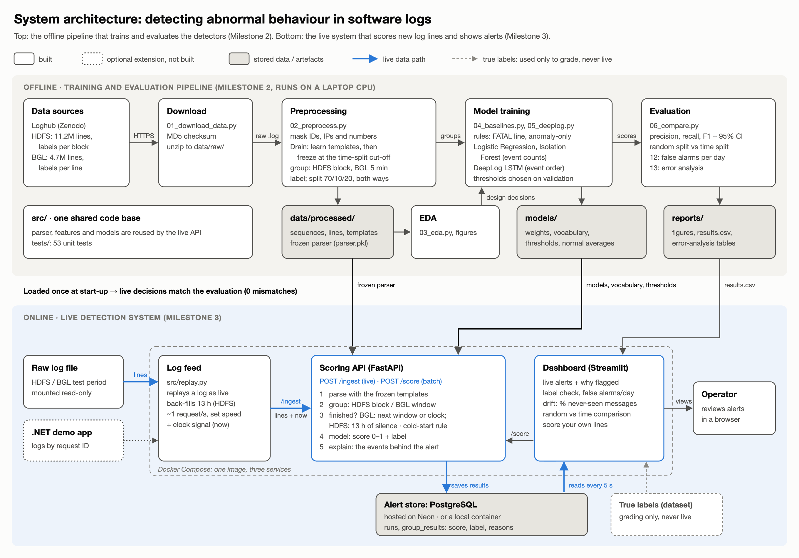

# Detecting Abnormal Behaviour in Software Systems Using Log Data and Machine Learning

CS5998 Capstone Project, MSc Data Science & AI. Student: Aaruran Ladchumanan (268442D)

The system reads raw software logs, learns what normal behaviour looks like, and
flags groups of log lines that look abnormal. It also tests a question most
published work skips: **do the reported near-perfect results still hold when a
model is trained only on past logs and tested on future logs?**

| Scope item | Choice |
|---|---|
| Problem type | Detection (classify each group of logs as normal / abnormal) |
| Data type | Time series of log events, created from text log files |
| Technique category | Machine learning and deep learning |
| System context | End-to-end pipeline + comparative analysis, served as an API and dashboard |

## System architecture



Top: the offline pipeline that trains and evaluates the detectors. Bottom: the live system.
The live API loads the frozen parser, models and thresholds made offline, so its decisions
match the evaluated ones exactly. Editable source: [docs/architecture.svg](docs/architecture.svg).

## Datasets

| Dataset | Source | Size | Group unit | Labels |
|---|---|---|---|---|
| HDFS v1 | [Loghub, Zenodo 8196385](https://zenodo.org/records/8196385) | 11.2M lines, 38.7 h | file block (`blk_...`) | per block |
| BGL | [Loghub, Zenodo 8196385](https://zenodo.org/records/8196385) | 4.7M lines, 215 days | 5-minute time window | per line → per window |

## Project structure

```
├── scripts/
│   ├── 01_download_data.py   # download + checksum + unzip the raw datasets
│   ├── 02_preprocess.py      # load → parse → group → label → split
│   ├── 03_eda.py             # exploratory data analysis → figures + statistics
│   ├── 04_baselines.py       # rules, Logistic Regression, Isolation Forest
│   ├── 05_deeplog.py         # DeepLog LSTM (improved method)
│   ├── 06_compare.py         # random vs time split comparison → tables + figure
│   ├── 08_check_engine.py    # proves the scoring engine reproduces the evaluated results
│   ├── 09_choose_quiet_time.py  # data behind the live HDFS rule (when is a block finished?)
│   ├── 10_check_api.py       # replays the test period through the API (cold start with / without the rule)
│   ├── 11_check_replay.py    # end to end: log feed → API → PostgreSQL vs the offline results (also via Docker)
│   ├── 12_false_alarms.py    # false alarms per day, and whether a false-alarm budget holds
│   └── 13_error_analysis.py  # what the served detectors' errors are, and a refined FATAL rule
├── src/
│   ├── config.py             # all paths, seeds, ratios and parser settings
│   ├── log_parser.py         # masking + Drain parser with a learn/freeze life-cycle
│   ├── hdfs.py               # HDFS-specific preprocessing (group by block)
│   ├── bgl.py                # BGL-specific preprocessing (group by time window)
│   ├── splits.py             # random vs chronological train/val/test splits
│   ├── eda.py                # EDA analysis functions (patterns, overlap, rules)
│   ├── features.py           # event-count features (log1p, training vocabulary)
│   ├── rules.py              # the two non-ML baseline rules
│   ├── baselines.py          # Logistic Regression and Isolation Forest
│   ├── deeplog.py            # DeepLog: LSTM next-event model
│   ├── metrics.py            # thresholds, precision/recall/F1, confidence intervals
│   ├── experiment.py         # shared train → validate → test procedure
│   ├── engine.py             # scoring engine: raw lines → score 0-1, label, reasons
│   ├── stream.py             # live scoring: score each group when it is finished
│   ├── api.py                # FastAPI scoring service (/score, /ingest, /flush, ...)
│   ├── store.py              # alert store: judged groups saved in PostgreSQL
│   ├── replay.py             # live log feed: replays a raw log file into the API
│   ├── dashboard_data.py     # the numbers behind the dashboard (tested separately)
│   ├── operations.py         # false alarms per day, alert budgets, bundled notifications
│   ├── plot_style.py         # one shared chart style and colour scheme
│   └── common.py             # shared helpers
├── dashboard/app.py          # Streamlit dashboard: live alerts, label check, drift, models
├── .streamlit/config.toml    # dashboard theme (same colours as the report figures)
├── tests/                    # unit tests (python -m pytest -q)
├── .env.example              # template for .env: the database connection string (.env is never committed)
├── Dockerfile                # one image for the API, the dashboard and the log feed
├── docker-compose.yml        # the live system: API + dashboard (+ log feed, optional local PostgreSQL)
├── docs/                     # explanation of each project step
├── reports/                  # figures, EDA statistics and model results
├── models/                   # trained models (generated, not committed)
└── data/                     # raw/ and processed/ (generated, not committed)
```

## How to reproduce

```bash
python3 -m venv .venv && source .venv/bin/activate
pip install -r requirements.txt

python scripts/01_download_data.py     # ~245 MB download, ~2.3 GB unzipped
python scripts/02_preprocess.py        # ~2 min on an Apple M2 laptop
python scripts/03_eda.py               # ~15 s, writes reports/figures/ and reports/eda_stats.json
python scripts/04_baselines.py         # ~15 s, rules + Logistic Regression + Isolation Forest
python scripts/05_deeplog.py           # ~3 min on CPU, DeepLog
python scripts/06_compare.py           # ~3 s, writes reports/results/ and the comparison figure
python scripts/08_check_engine.py      # ~35 s, scoring engine vs offline results
python scripts/09_choose_quiet_time.py # ~1.5 min, HDFS live rule from training + validation data
python scripts/10_check_api.py         # ~2.5 min, live API vs offline results, cold start with / without the rule
cp .env.example .env                   # then put the PostgreSQL connection string in .env
python scripts/11_check_replay.py      # ~2.5 min, log feed -> API -> PostgreSQL vs offline results
python scripts/12_false_alarms.py      # ~10 s, false alarms per day and alert budgets (+ figure 13)
python scripts/13_error_analysis.py    # ~5 s, error analysis of the served detectors
python -m pytest -q                    # unit tests
```

Run the live system with Docker (one command; needs the data and models from the scripts above and `.env`):

```bash
docker-compose up -d --build                     # API -> http://localhost:8000/docs, dashboard -> http://localhost:8501
docker-compose run --rm replay --dataset bgl     # the live log feed: replays the BGL test period
docker-compose down                              # stop everything
```

Or without Docker (three terminals; the alert database is set in `.env`):

```bash
uvicorn src.api:app                    # the scoring API     -> http://127.0.0.1:8000/docs
streamlit run dashboard/app.py         # the dashboard       -> http://localhost:8501
python -m src.replay --dataset bgl     # the live log feed: replays the BGL test period, 1 log hour per second
```

## Progress

| Step | Status | Notes |
|---|---|---|
| Data preprocessing | Done | [docs/01_data_preprocessing.md](docs/01_data_preprocessing.md) |
| Exploratory data analysis | Done | [docs/02_eda.md](docs/02_eda.md) |
| Baselines (rules, Logistic Regression, Isolation Forest) | Done | [docs/03_models.md](docs/03_models.md) |
| Improved model (DeepLog LSTM) | Done | [docs/03_models.md](docs/03_models.md) |
| Scoring engine (Milestone 3) | Done | [docs/04_scoring_engine.md](docs/04_scoring_engine.md) |
| Scoring API (Milestone 3) | Done | [docs/05_scoring_api.md](docs/05_scoring_api.md) |
| Live log feed + alert store (Milestone 3) | Done | [docs/06_live_feed_and_store.md](docs/06_live_feed_and_store.md) |
| Live dashboard (Milestone 3) | Done | [docs/07_dashboard.md](docs/07_dashboard.md) |
| Whole system in Docker (Milestone 3) | Done | [docs/08_docker.md](docs/08_docker.md) |
| False alarms per day + error analysis (Milestone 3) | Done | [docs/09_false_alarms_and_errors.md](docs/09_false_alarms_and_errors.md) |
| Final report + reproducibility checklist (Milestone 3) | Planned | |
