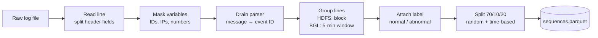

# Step 1 – Data Preprocessing

**Goal of this step:** turn millions of raw text log lines into clean, labelled
*sequences of event IDs*, split into training / validation / test sets in two
ways (random and time-based), so that every model in the next steps starts from
exactly the same data.

Code: [`scripts/02_preprocess.py`](../scripts/02_preprocess.py) and [`src/`](../src).
Run time: about 2 minutes on an Apple M2 laptop (HDFS 84 s, BGL 27 s).

---

## 1. Why preprocessing is needed

Machine-learning models cannot read sentences. They need numbers. A raw log line
is a sentence mixed with variable values:

```
081109 203518 143 INFO dfs.DataNode$DataXceiver: Receiving block blk_-1608999687919862906 src: /10.250.19.102:54106 dest: /10.250.19.102:50010
```

Preprocessing answers four questions:

| Question | Answer in this project |
|---|---|
| *What kind of message is this?* | Log parsing gives every line an **event ID** (e.g. "Receiving block …" = event 1) |
| *Which lines belong together?* | **Grouping**: HDFS by block ID, BGL by 5-minute window |
| *Is this group normal or abnormal?* | **Labels** from the Loghub ground truth |
| *Which data may the model learn from?* | **Splitting** into train / validation / test, randomly and by time |

## 2. The pipeline



The file is read **twice**: pass 1 only finds the groups and decides the splits.
Pass 2 does the parsing, because the parser needs to know the training cut-off
time (see section 3.4).

## 3. Each step explained

### 3.1 Download and integrity check
[`scripts/01_download_data.py`](../scripts/01_download_data.py) downloads `HDFS_v1.zip` and `BGL.zip`
from Loghub (Zenodo record 8196385) and checks each file's **MD5 checksum**. A
checksum is a fingerprint of the file. If it matches the published value, the
file is complete and unchanged, so anyone re-running the project gets
byte-identical input.

### 3.2 Reading each line (loading)
Each dataset has a fixed header format, so the line is split into fields:

| Dataset | Fields | What we keep |
|---|---|---|
| HDFS | date, time, process ID, level, component, **content** | timestamp, level, component, content |
| BGL | **label**, unix time, date, node, full time, node, type, component, level, **content** | timestamp, label, node, component, level, content |

Data quality findings:
- **HDFS:** all 11,175,629 lines matched the format (0 malformed). Lines are in time order.
- **BGL:** all 4,747,963 lines were readable. Lines are in time order. **34,470 lines have an
  empty message** (header only, level FATAL). They are kept and given the
  message `<EMPTY>`, because "a FATAL record with no text" is itself information.
- **BGL, found later during EDA:** 324 lines have no node (`-`) *and* are missing the
  repeated node field, so every later field shifted one place left (e.g. the level
  became `Kill`). The parser now detects and repairs them. 18 further lines are
  genuinely corrupted (fragments of other messages inside the header, typical of two
  processes writing at once) and are left as they are (0.0004% of lines).
  See [02_eda.md](02_eda.md).
- BGL's first field is the **answer** (label). It is stored separately and never
  given to the parser or to the models. Using it as an input would be cheating
  (label leakage).

### 3.3 Masking variable values
Some parts of a message are obviously variables. We replace them before parsing
with regular expressions ([`src/log_parser.py`](../src/log_parser.py)):

| Pattern | Example | Becomes |
|---|---|---|
| HDFS block ID | `blk_-1608999687919862906` | `<BLK>` |
| IP address (+ port) | `10.250.19.102:54106` | `<IP>` |
| Hexadecimal value | `0x0b85eee0` | `<HEX>` |
| Plain number | `67108864` | `<NUM>` |

```
before: Receiving block blk_-1608999687919862906 src: /10.250.19.102:54106 dest: /10.250.19.102:50010
after:  Receiving block <BLK> src: /<IP> dest: /<IP>
```

**Why:** masking makes Drain's job easier and more accurate. Without it, two
lines that differ only by an IP address could end up as different "events".

### 3.4 Log parsing with Drain
**Drain** (He et al., 2017) is the most widely used log parser. It groups messages
into **templates** (event types) without needing any labels:

1. Messages are first sorted by **number of words** (tokens).
2. Then by their **first words**. Together these form a small tree, which makes it fast.
3. In the final "leaf", the message joins the existing template that is most
   similar, if at least **50% of the words match** (`sim_th = 0.5`). Otherwise a
   new template is created.
4. Words that differ between messages of the same template become `<*>`.

Settings (`sim_th = 0.5`, `depth = 4`) follow the Loghub parser benchmark
(Zhu et al., 2019), which used the same values for HDFS and BGL.

**Leakage protection: learn, then freeze.** In real life a parser can only learn
from logs that already exist. So the parser **learns only from lines written
before the training cut-off** and is then **frozen**. After that it may only
*match* messages to templates it already knows. Messages that match nothing get
event ID **0 = `<UNSEEN>`**, the same thing a deployed system would face.

The same frozen parser is used for both split experiments. The only difference
between Experiment 1 (random) and Experiment 2 (time-based) is therefore how the
groups are split, which keeps the comparison fair (a controlled experiment).

| | HDFS | BGL |
|---|---|---|
| Lines the parser learned from | 8,041,566 (72%) | 3,681,812 (78%) |
| Lines matched after freezing | 3,134,063 | 1,066,151 |
| …of which **unseen** templates | **3 (0.0001%)** | **425,120 (39.9%)** |
| Templates found | 45 | 622 |

**Checked against Loghub's 29 reference templates for HDFS:** our 45 templates are
mostly *finer*. For example, "writeBlock received exception" is split by exception
type, and the extra templates are rare (each < 0.03% of lines). In one case Drain
*merged* two reference templates: "PacketResponder … terminating" (1,706,679 lines)
and "PacketResponder … Interrupted." (49 lines) differ by only one word, so both
became template 3 (see limitations).

### 3.5 Grouping lines into sequences
Anomalies are judged on **groups** of lines, not single lines.

- **HDFS → by block ID.** Every operation on a file block writes lines that mention
  the block's ID, so all lines for one block form a natural "session".
  If one line mentions two blocks, it is added to both. Result: **575,061 blocks**,
  median **19 events** per block (min 2, max 298).
- **BGL → by fixed 5-minute windows.** BGL has no session ID, so the timeline is
  cut into non-overlapping windows aligned to the clock (00:00–00:05, …). Empty
  windows are not created. Result: **14,494 windows**, median **6 events**
  (max 42,272 during an error storm).

Why 5 minutes? We compared window sizes before choosing:

| Window | Windows | Abnormal windows | Comment |
|---|---|---|---|
| 1 min | 27,670 | 6.6% | more data, but alerts split across windows |
| **5 min** | **14,494** | **7.3%** | abnormal rate ≈ alert-line rate (7.34%); a realistic alerting interval |
| 15 min | 8,623 | 10.0% | |
| 60 min | 3,619 | 18.4% | too few windows, too coarse for alerting |

### 3.6 Labels
- **HDFS:** Loghub's `anomaly_label.csv` labels each block. 16,838 of 575,061 blocks
  are abnormal (**2.93%**). Every block found in the log has a label.
- **BGL:** each line is labelled (`-` = normal, otherwise an alert type such as
  `KERNDTLB`). A window is **abnormal if it contains at least one alert line**.
  1,054 of 14,494 windows are abnormal (**7.27%**).

Both datasets are **imbalanced** (few anomalies). That is why later steps use
precision, recall and F1, not accuracy. A model that always says "normal" would
already be 97% accurate on HDFS.

### 3.7 Splitting: random vs time-based (the core of the project)
Groups are split **70% train / 10% validation / 20% test** in two ways
([`src/splits.py`](../src/splits.py)):

- **Random split** (common in published papers): shuffle all groups (fixed seed 42),
  then cut. It is *stratified*: each part keeps the same anomaly rate.
  The model trains on groups from the whole time range, so it "sees the future".
- **Time-based (chronological) split** (realistic): sort groups by start time.
  The oldest 70% go to training, the next 10% to validation, the newest 20% to test.

**HDFS (575,061 blocks)**

| Split | Part | Blocks | Anomalies | Rate | Time range (start) |
|---|---|---|---|---|---|
| Random | train / val / test | 402,543 / 57,506 / 115,012 | 11,787 / 1,684 / 3,367 | 2.93% each | whole period |
| Time | train | 402,543 | 13,115 | 3.26% | 9 Nov 20:35 → 11 Nov 06:00 |
| Time | val | 57,506 | 2,044 | 3.55% | 11 Nov 06:00 → 07:42 |
| Time | test | 115,012 | 1,679 | **1.46%** | 11 Nov 07:42 → 11:04 |

**BGL (14,494 windows)**

| Split | Part | Windows | Anomalies | Rate | Time range (start) |
|---|---|---|---|---|---|
| Random | train / val / test | 10,146 / 1,449 / 2,899 | 738 / 105 / 211 | 7.27% each | whole period |
| Time | train | 10,146 | 807 | 7.95% | 3 Jun → 31 Oct 2005 |
| Time | val | 1,449 | 22 | **1.52%** | 31 Oct → 9 Nov 2005 |
| Time | test | 2,899 | 225 | 7.76% | 9 Nov 2005 → 4 Jan 2006 |

## 4. First findings (already useful for the report)

1. **The anomaly rate changes over time.** With a random split, every part has
   exactly 2.93% (HDFS) or 7.27% (BGL) anomalies. With a time split, the HDFS
   test period has only 1.46% (half the training rate), and the BGL validation
   period only 1.52%. The future does not look like the past.
2. **BGL's logs changed during the 7 months.** About 40% of BGL lines after the
   cut-off match no template learned before it. Two reasons, both checked in the raw data:
   - **New messages**, for example `microseconds spent in the rbs signal handler…`
     (135,096 lines, all between 1 and 4 Dec 2005), or `MACHINE CHECK DCR read timeout`
     (14,481 lines on 21 Nov 2005).
   - **Re-worded messages** (likely a software update). Before 31 Oct:
     `ciod: Error reading message prefix after LOAD_MESSAGE on CioStream socket to <IP>: Link has been severed`.
     After: `ciod: Error reading message prefix on CioStream socket to <IP>, Link has been severed`.
     Same meaning, different words, so a frozen parser cannot recognise it.

   This "log instability" (Zhang et al., 2019) is hidden by a random split and
   is a main reason models may perform worse in Experiment 2.
3. **HDFS's logs are stable.** Only 3 lines after the cut-off are unseen, so any HDFS
   performance drop in Experiment 2 must come from something else (e.g. the
   changing anomaly rate), not from the parser.

## 5. Output files

All written to `data/processed/<hdfs|bgl>/` (large files are not committed to Git;
re-create them with the scripts):

| File | One row per | Main columns |
|---|---|---|
| `sequences.parquet` | group (block / window) | `event_ids` (list), `n_events`, `start_time`, `end_time`, `label`, `split_random`, `split_time` |
| `lines.parquet` | log line | `timestamp`, `event_id`, `level`, `component` (+ BGL: `is_alert`, `alert_type`, `node`) |
| `templates.csv` | event template | `event_id`, `template`, `occurrences`, `occurrences_learning_period` |
| `summary.json` | dataset | all counts and split statistics shown above |
| `parser.pkl` | – | the frozen Drain parser, saved for the scoring engine (added in Milestone 3, docs/04_scoring_engine.md) |

*Parquet* is a compressed, column-based file format: much smaller and faster
to load than CSV, and it keeps data types (dates stay dates, lists stay lists).

## 6. Design decisions and why

| Decision | Why | Alternative considered |
|---|---|---|
| Parse with Drain | Most-used parser, no labels needed, fast, benchmarked on these datasets | Loghub's pre-parsed files: quicker, but parsed with *all* data (leakage) and no control over the process |
| Mask IDs/IPs/numbers before Drain | Fewer false templates; recommended by the Loghub benchmark | No masking: more noisy templates |
| Parser learns only before the cut-off, then frozen | Prevents test data from shaping the parser (Milestone 1 risk) | Parse everything at once: common in papers, but optimistic |
| Same parser for both split experiments | Only the split differs, so the comparison is controlled | Separate parser per experiment |
| Unseen messages → event 0 | Mirrors real deployment; makes drift measurable | Drop them: would hide the problem |
| HDFS group = block | Natural session; labels exist per block | — |
| BGL group = 5-min window | Abnormal rate stays close to line-level rate; realistic alert interval; enough windows | 1 h windows (too few, 18% abnormal), count windows of N lines |
| Stratified random split, seed 42 | Same anomaly rate in every part; reproducible | Plain shuffle |
| Split on groups, not lines | A block / window must never be cut between train and test | — |

## 7. Known limitations

- Drain separates messages by word count, so one event with a variable-length
  parameter list can become two templates (e.g. HDFS events 11 and 9:
  "replicate to datanode(s) `<IP>`" vs "`<IP>` `<IP>`").
- The opposite also happens: messages with the same length that differ by one
  important word can be merged. 49 HDFS "PacketResponder … Interrupted." lines
  share a template with 1.7M "… terminating" lines. The effect is tiny (0.0004%
  of lines), but it shows that parsing errors can hide useful signals.
- Re-worded messages (BGL) become `<UNSEEN>`, so their meaning is lost. Methods
  that compare message *meaning* (e.g. word embeddings, as in LogRobust) could
  help, but are outside this project's scope.
- BGL's time-based validation set has only 22 abnormal windows, so thresholds
  tuned on it will be uncertain. This will be reported in the evaluation.
- BGL times are converted from the unix timestamp to UTC. The raw text shows
  US Pacific local time (7–8 hours earlier).

## 8. Questions a lecturer might ask

**Why not just use Loghub's already-parsed files?** They were created by parsing the
whole dataset at once, so templates were shaped by test data. To test
realistically, the parser must not see the future, so we parse ourselves.

**What is data leakage, and where could it happen here?** Leakage is when the model
(or any step before it) gets information it would not have in real use. Three
places are protected: (1) the label field of BGL is never an input; (2) the parser
learns only from training-period logs; (3) splits are made on whole groups.
Later, (4) thresholds and feature vocabularies will be fitted on training and
validation data only.

**Why is a random split optimistic?** Logs from the same time period are very
similar (same software version, same workload, same incident). With a random
split, the training set contains logs from right next to every test log. The
test becomes "spot the difference" instead of "predict the future".

**Why stratify the random split but not the time split?** Stratifying the random
split makes it as *fair* as possible, so any gap to the time split comes from
time, not from luck. The time split cannot be stratified without breaking time
order, and the changing anomaly rate is a real effect we want to measure.

**What happens to a log message the system has never seen?** It becomes event 0
(`<UNSEEN>`). We count them (3 in HDFS, 425,120 in BGL) and the models will treat
event 0 as a normal input value.

## References

- He, P., Zhu, J., Zheng, Z., Lyu, M. R. (2017). *Drain: An Online Log Parsing Approach with Fixed Depth Tree.* IEEE ICWS.
- Zhu, J. et al. (2019). *Tools and Benchmarks for Automated Log Parsing.* ICSE-SEIP.
- Zhu, J., He, S., He, P., Liu, J., Lyu, M. R. (2023). *Loghub: A Large Collection of System Log Datasets for AI-driven Log Analytics.* ISSRE.
- Zhang, X. et al. (2019). *Robust Log-Based Anomaly Detection on Unstable Log Data* (LogRobust). ESEC/FSE.
- Le, V.-H., Zhang, H. (2022). *Log-based Anomaly Detection with Deep Learning: How Far Are We?* ICSE.
