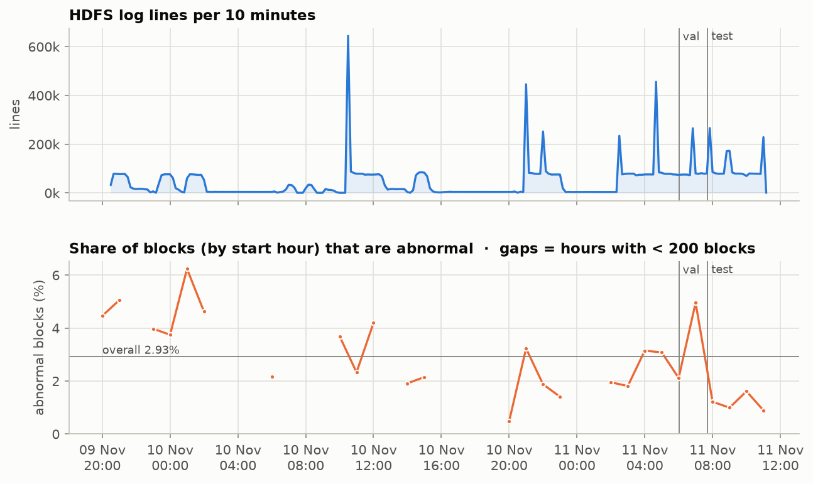
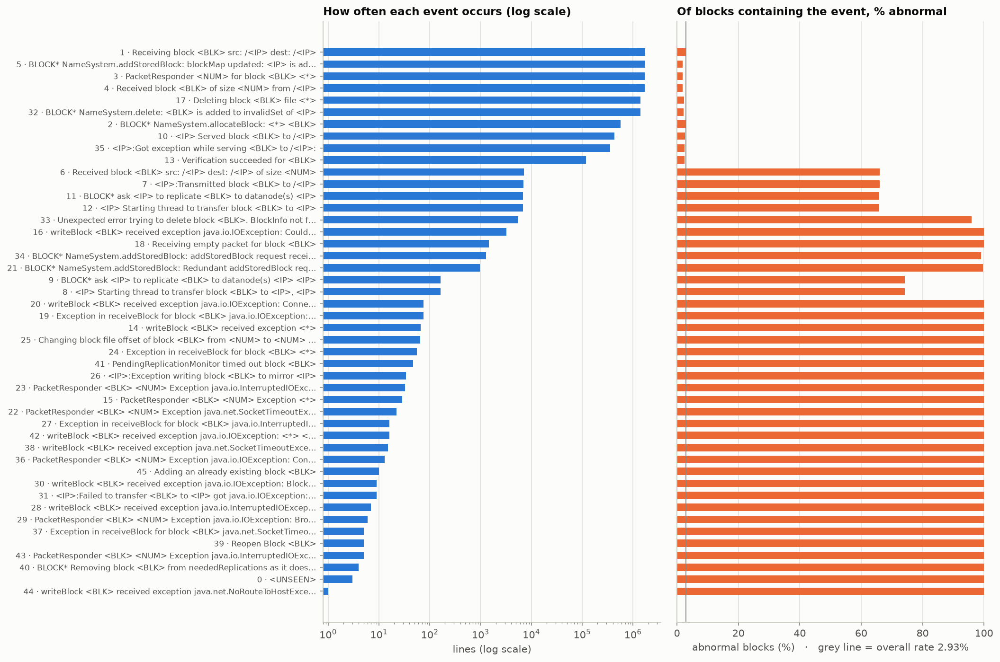
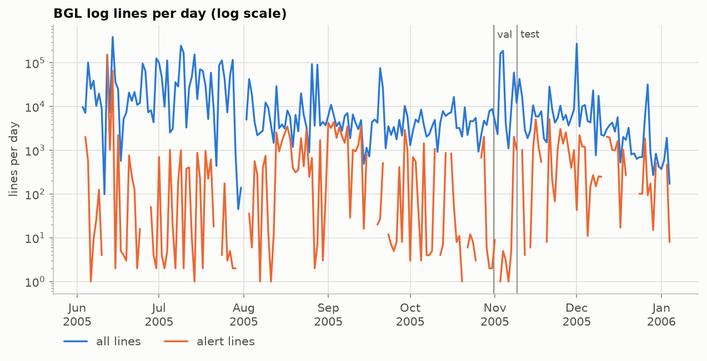
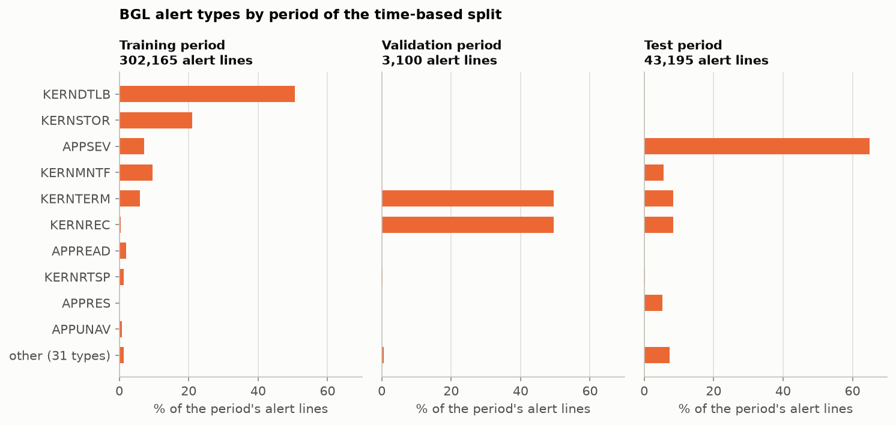
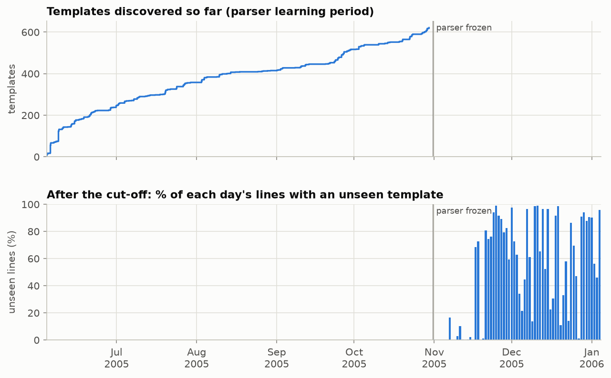
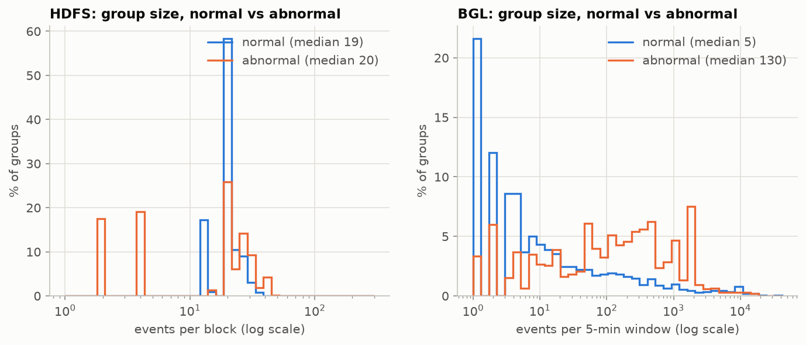
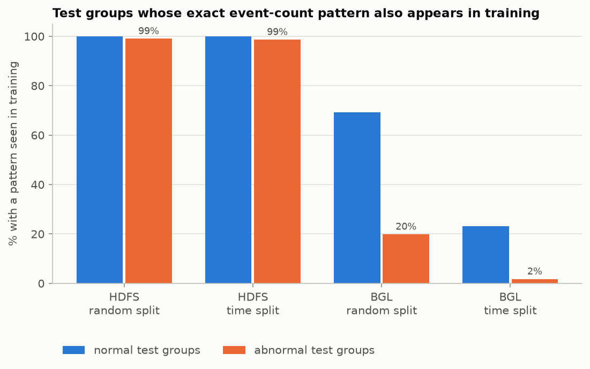

# Step 2 – Exploratory Data Analysis (EDA)

**Goal of this step:** look carefully at the preprocessed data *before* training any
model, to (1) understand what normal and abnormal behaviour look like, (2) find
data problems, and (3) make modelling decisions based on evidence instead of guesses.

Code: [`scripts/03_eda.py`](../scripts/03_eda.py) (analysis and figures),
[`src/eda.py`](../src/eda.py) (reusable functions, unit-tested in [`tests/test_eda.py`](../tests/test_eda.py)).
All numbers are saved in [`reports/eda_stats.json`](../reports/eda_stats.json).

```bash
python scripts/03_eda.py     # ~15 s, after scripts/02_preprocess.py
```
In VS Code each `# %%` block of the script can also be run on its own ("Run Cell"), like a notebook.

---

## Key findings at a glance

| # | Finding | Why it matters |
|---|---|---|
| 1 | Both datasets are **imbalanced** (2.93% / 7.27% abnormal) and the **anomaly rate changes over time** (HDFS hourly: 0.5%–6.2%) | Use precision / recall / F1, not accuracy. A time-based test set has a different anomaly rate than training |
| 2 | HDFS is **extremely repetitive**: 575,061 blocks have only **597 different event-count patterns**. Even with a time split, **99%** of abnormal test blocks have a pattern already seen in training | HDFS will probably stay "easy" even under a time split |
| 3 | BGL is the opposite. Under a time split, only **1.8%** of abnormal test windows have a pattern seen in training (random split: 19.9%) | BGL is where the random-vs-time difference should show most |
| 4 | **BGL's failures change type over time.** Training alerts are 50.5% KERNDTLB; test alerts are 0% KERNDTLB and 65% APPSEV. 6 alert types in the test period never occur in training | A supervised model trained on old failures meets new kinds of failures |
| 5 | **BGL's messages change over time.** New templates appear every month; after the cut-off, 39.9% of lines and **62.8% of test windows** contain an unseen message | Models must cope with event 0 (`<UNSEEN>`); expect more false alarms |
| 6 | **36.8% of abnormal HDFS blocks are shorter than any normal block.** Their anomaly is *missing* events (a write that started and never finished) | A next-event model (DeepLog) needs a way to notice "the sequence ended too early" |
| 7 | In BGL every alert line has level **FATAL** or **FAILURE**. The rule "flag a window with a FATAL line" catches **100%** of abnormal windows with 60% precision | A strong no-ML baseline that every model must beat |
| 8 | Data quality: 324 BGL lines had shifted header fields (**repaired**), 18 are corrupted (kept) | EDA found a preprocessing bug, which was fixed |

---

## 1. HDFS over time



**How to read it:** top, how many log lines were written every 10 minutes; bottom,
for blocks starting in each hour, the % that are abnormal. The grey lines show where
the validation and test periods of the time-based split begin.

- Log volume is **bursty**: median 16,757 lines per 10 minutes, peaks of 644,359,
  with quiet stretches in between (e.g. overnight on 10 Nov).
- The abnormal rate is **not constant**: between 0.48% and 6.24% per hour (overall 2.93%).
  The test period (after 11 Nov 07:42) sits around 0.9–1.6%. This is why the time-split
  test set has only 1.46% anomalies while training has 3.26%.
- Levels: 97% INFO, 3% WARN. HDFS has no ERROR level at all, so "look for errors" is not an option.

## 2. HDFS events: frequency and anomaly signal



**How to read it:** one row per event template. Left: how often it occurs (log scale,
see the box below). Right: of all blocks that contain this event at least once,
the % that are abnormal. The grey line is the overall rate (2.93%). Bars far to the
right of it are anomaly signals.

- **Very unequal frequencies:** the top 10 templates make up **99.63%** of all lines.
  Most templates are rare.
- **26 of the 45 templates never appear in a normal block** (mostly exceptions:
  `writeBlock … received exception`, `Receiving empty packet`, `PacketResponder … Exception`).
  Seeing one of them is an almost certain anomaly.
- Replication events (`ask … to replicate`, `Starting thread to transfer`, `Transmitted block`)
  occur in ~66% abnormal blocks. Replication happens when something went wrong with a copy.
- But rare "error" events only explain part of the anomalies (see section 9). Many
  abnormal blocks contain only ordinary events, in unusual numbers.

> **Log scale, simply explained:** each step on the axis is ×10 (1, 10, 100, 1,000 …).
> It lets values from 1 to 1,700,000 fit on one chart. Without it, every rare event
> would be an invisible bar.

## 3. BGL over 7 months



- Logs on 215 of 216 days, alerts on 189 days.
- Volume swings by more than **1,000×** between days (median 5,086 lines per day;
  busiest day 14 Jun 2005 with 392,069 lines).
- Alerts come in **storms**: some days have over 100,000 alert lines, many have none.
  So an anomaly is usually a burst, not a single line.

## 4. BGL alert types and how they change



There are 41 alert types (each alert line carries one). Overall, KERNDTLB (43.8%),
KERNSTOR (18.2%) and APPSEV (14.3%) dominate. But split by the **periods of the
time-based split**, the picture changes completely:

| Alert type | Training period | Validation period | Test period |
|---|---|---|---|
| KERNDTLB | 50.5% | 0% | 0% |
| KERNSTOR | 21.0% | 0% | 0% |
| APPSEV | 7.1% | 0% | **65.0%** |
| KERNTERM | 6.0% | 49.5% | 8.3% |
| KERNREC | 0.3% | 49.5% | 8.3% |
| Alert lines | 302,165 | 3,100 | 43,195 |

Six types appear in the test period but **never** in training (APPOUT, APPTO, KERNSERV,
KERNTLBE, LINKBLL, MONILL). A model trained on the past is asked to recognise
failures it has never seen. With a random split, all types are mixed into
training, so this problem stays hidden.

## 5. BGL: is the severity level the same as the label?

| Level | Normal lines | Alert lines |
|---|---|---|
| FATAL | 507,103 | **348,398** |
| FAILURE | 1,652 | **62** |
| INFO | 3,735,805 | 0 |
| ERROR | 112,355 | 0 |
| WARNING | 23,357 | 0 |
| SEVERE | 19,213 | 0 |

**Every alert line has level FATAL or FAILURE**, but most FATAL lines are not alerts.
A no-ML rule, "flag a 5-minute window if it contains any FATAL or FAILURE line", gives:

| | Abnormal windows caught (recall) | Flags that are correct (precision) |
|---|---|---|
| All windows | 100% | 60.2% |
| Time-split test windows | 100% | 65.6% (F1 ≈ 0.79) |

This rule needs no training at all and is not affected by drift. It becomes an extra
**baseline**: a machine-learning model for BGL is only useful if it beats F1 ≈ 0.79.
(The level is visible in every log line at run time, so using it is legitimate,
not leakage.)

## 6. BGL: the messages themselves change (concept drift)



**Concept drift** means the data a model sees in use gradually differs from the data
it was trained on.

- **Top:** during the 5 learning months the parser keeps finding new templates every
  month (Jun 247, Jul 111, Aug 57, Sep 102, Oct 105). The curve never flattens:
  BGL's "vocabulary" never settles.
- **Bottom:** after the parser is frozen, the share of unseen lines stays low for
  about two weeks, then jumps. On **35 days** more than half of all lines are unseen.
  Overall 39.9% of lines after the cut-off are unseen (step 1 showed why: new and
  re-worded messages).
- Per window: 0% of training windows, 1.9% of validation windows and **62.8% of test
  windows** (time split) contain at least one unseen event.
- HDFS, by comparison: only 3 unseen lines.

## 7. Group sizes: normal vs abnormal



**How to read it:** a histogram shows how many groups (y, in % of that class) have a
given number of events (x, log scale). Blue = normal, orange = abnormal.

- **HDFS:** the shortest normal block has 13 events, yet **6,193 abnormal blocks (36.8%)
  are shorter** (often just 2 or 4 events). The most common short patterns:
  `allocateBlock → Receiving block` (2,950 blocks in two orders) and
  `allocateBlock → Receiving → Receiving → writeBlock exception` (1,361).
  A file block was allocated and a write started, then **nothing**: the anomaly is the
  events that are *missing*.
- **BGL:** abnormal windows are much bigger (median 130 events vs 5 for normal) because
  alerts come in storms. Window sizes range from 1 to 42,272 events, a very skewed
  distribution.

## 8. Random vs time split: has the model "seen" the test data before?



A group's **count pattern** = how many times each event occurs in it, which is exactly
what the count-based models (Logistic Regression, Isolation Forest) receive as input.
For every test group we ask: did this *exact* pattern already occur in the training set?

| | Normal test groups seen | Abnormal test groups seen | Distinct patterns (all groups) |
|---|---|---|---|
| HDFS random split | 99.98% | 99.05% | 597 of 575,061 blocks |
| HDFS time split | 99.93% | 98.69% | |
| BGL random split | 69.2% | 19.9% | 5,471 of 14,494 windows |
| BGL time split | 23.2% | **1.8%** | |

- **HDFS** repeats itself so much that almost every test block, normal or abnormal,
  is a "copy" of a training block, *whichever split is used*. This explains the
  near-perfect scores in the literature and predicts that HDFS will **not** show a
  big random-vs-time difference.
- **BGL** under a time split: almost no abnormal test window has been seen before.
  **Hypothesis for the experiments:** BGL results will drop clearly from the random to
  the time split; HDFS results will change little.

**Label conflicts.** Some patterns occur with *both* labels: 9 patterns in HDFS
(319 abnormal and 231 normal blocks, i.e. 1.9% of anomalies) and 9 in BGL (16 abnormal
and 366 normal windows, 1.5%). A count-based model sees identical inputs for these, so it
can never get all of them right. This is a ceiling on what such models can reach.

## 9. How far does a trivial rule get?

Rule: *flag a group if it contains any event that never appeared in a **normal**
training group.* The events are picked from training data only, then the rule is
checked on the test set.

| | Abnormal test groups caught | Flags that are correct |
|---|---|---|
| HDFS random split | 22.9% | 100% |
| HDFS time split | 43.2% | 100% |
| BGL random split | 91.5% | 99.5% |
| BGL time split | 60.4% | 99.3% |

- **HDFS:** the rule catches only a minority. Most HDFS anomalies are made of *ordinary*
  events in unusual amounts or with events missing, so real models are needed. (It
  catches more under the time split because the HDFS test period happens to contain
  more "obvious" anomalies: 43% of its abnormal blocks contain an exception event,
  vs 21% in training.)
- **BGL:** with a random split, 91.5% of abnormal test windows can be caught by
  simple lookup of "known bad" events. With a time split this falls to 60.4%, which
  is the drift from sections 4 and 6 in one number.

## 10. Data quality issues found

| Issue | Lines | Action |
|---|---|---|
| BGL: node missing **and** repeated-node field missing, so all later fields shifted (level showed up as `Kill`, content lost its first word) | 324 | **Fixed** in [`src/bgl.py`](../src/bgl.py) and covered by a unit test. Preprocessing re-run |
| BGL: corrupted header (fragments of other messages, e.g. `time for a single instance of a correctable ddr.` inside the node field) | 18 | Kept as is (0.0004%). Typical of two processes writing to a log at once |
| BGL: empty message | 34,470 | Kept as `<EMPTY>` (step 1) |
| HDFS | 0 | Clean |

This shows why EDA comes **before** modelling: the first EDA run revealed impossible
log levels (`Kill`, `single`, `microseconds`), which led to the bug fix.

## 11. What this means for the modelling step

| Evidence from EDA | Decision for modelling |
|---|---|
| Imbalance (2.93% / 7.27%), changing anomaly rate | Report precision, recall, F1. Use class weights in Logistic Regression. Choose alert thresholds on the validation set only |
| Very skewed event counts (1 to 42,272 per window) | Transform counts with log(1 + count) before Logistic Regression / Isolation Forest |
| HDFS anomalies often = missing events (short blocks) | Give DeepLog an explicit end-of-sequence event so "ended too early" becomes detectable |
| Unseen events (BGL test: 62.8% of windows) | Keep event 0 as its own feature/input. Analyse how many false alarms it causes |
| BGL validation period has only 22 abnormal windows, of different alert types than the test period | Thresholds tuned on validation may transfer poorly; report this honestly and test sensitivity |
| FATAL rule F1 ≈ 0.79 on BGL; "anomaly-only events" rule | Include both as non-ML baselines in the comparison |
| Label conflicts (~1.5–1.9% of anomalies) | Explains why count-based models cannot reach 100% recall without false alarms |
| HDFS: 99% of test patterns seen before; BGL: 1.8% | Hypothesis: large random-vs-time gap on BGL, small on HDFS |

## 12. Questions a lecturer might ask

**What is EDA and why do it before modelling?** Looking at the data with statistics and
charts to understand it. Here it found a parsing bug, showed that HDFS repeats itself,
and revealed drift in BGL. All of these change how the models are built and how the
results should be interpreted.

**Why is HDFS called an "easy" dataset?** Only 597 different count patterns exist among
575,061 blocks, and 99% of test anomalies have a pattern already seen in training.
A model can do well by recognising repeats.

**What is concept drift, and what is your evidence?** The data changing over time.
Evidence: new templates every month, 39.9% unseen lines after the cut-off, re-worded
messages, and alert types that change completely between periods.

**Isn't the FATAL rule cheating?** No. The severity level is part of every log line and
is available when the system runs. It is not the label. But it shows that BGL's labels
are strongly tied to severity, so it is a fair and demanding baseline.

**Why not remove the 18 corrupted lines?** They are 0.0004% of the data. Real systems
produce such lines too, so a robust pipeline should survive them.

**Why compare exact count patterns?** Because count-based models only see counts. If a
test group's counts match a training group, the model is effectively being tested on
something it has already seen.
