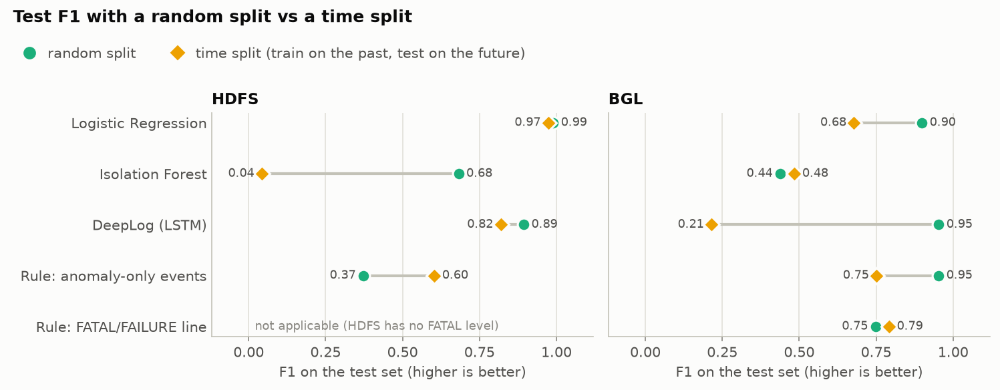
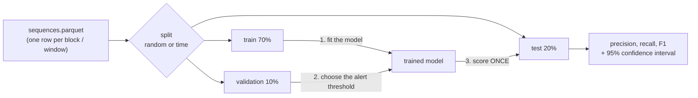

# Step 3 – Baselines and improved method (DeepLog)

**Goal of this step:** train the models promised in Milestone 1 and answer the core
research question: *do the near-perfect results reported in papers still hold when a
model is trained on past logs and tested on future logs?*

Every model is trained and tested **twice per dataset**:

| Experiment | How train / validation / test are cut | What it simulates |
|---|---|---|
| **Random split** | groups shuffled, then cut 70 / 10 / 20 | what most published papers do |
| **Time split** | the oldest 70% train, the next 10% validation, the newest 20% test | real use: learn from the past, detect in the future |

Code:
- [`scripts/04_baselines.py`](../scripts/04_baselines.py): two rules, Logistic Regression and Isolation Forest.
- [`scripts/05_deeplog.py`](../scripts/05_deeplog.py): DeepLog.
- [`scripts/06_compare.py`](../scripts/06_compare.py): tables and the figure.

Building blocks in [`src/`](../src) (features, metrics, rules, baselines, deeplog, experiment) are
unit-tested in [`tests/test_models.py`](../tests/test_models.py).

```bash
python scripts/04_baselines.py   # ~15 s
python scripts/05_deeplog.py     # ~3 min on a laptop CPU
python scripts/06_compare.py     # ~3 s  -> reports/results/*.csv, reports/figures/08_f1_random_vs_time.png
```

---

## Key results at a glance



**How to read it:** each row is one detector. The green circle is its test F1 with the
random split, the yellow diamond with the time split. A long line means the score
changed a lot when the model had to predict the future.

| # | Finding | Evidence |
|---|---|---|
| 1 | **On BGL, the random split gives a false picture.** DeepLog drops from F1 **0.95 → 0.21**, Logistic Regression from **0.90 → 0.68** | §9, §10.4, §10.5 |
| 2 | **On HDFS, the supervised model holds up** (Logistic Regression 0.99 → 0.97), as the EDA predicted | §10.1 |
| 3 | **A simple rule beats every ML model on BGL in the realistic setting.** "Flag a window with a FATAL/FAILURE line" gets F1 **0.79** | §10.6 |
| 4 | The time split exposed **two kinds of drift**: new log messages (BGL, 62.8% of test windows) and a **change of normal workload** (HDFS: 60% of normal test blocks are never deleted, against 8.7% in training and 0% in validation) | §10.2, §10.4 |
| 5 | **Validation stops being a reliable preview.** Under the random split validation F1 ≈ test F1; under the time split, e.g. Isolation Forest HDFS validation **0.97** vs test **0.04** | §10.7 |
| 6 | DeepLog is **not** better than Logistic Regression on HDFS (0.89 vs 0.99). It does not use labels, and labels are a strong advantage here | §10.3 |

---

## 1. The experiment design (why the comparison is fair)



- **Same input for everyone:** all detectors see the same groups and the same splits.
  The same frozen Drain parser is used for every group (step 1).
- **Same procedure for everyone:**
  1. Fit on train.
  2. Pick the threshold that gives the best F1 on validation.
  3. Apply that threshold to test once.
- **No test peeking:** the test set is never used to choose anything. No model setting
  was changed after the test results were seen (see the honesty note in §12).
- **Seed 42 everywhere:** re-running gives the same numbers (checked by running the
  baselines twice and comparing).

The five detectors use labels in different ways:

| Detector | Type | Uses labels in training? | Looks at |
|---|---|---|---|
| Rule: FATAL/FAILURE line (BGL only) | rule, no training | no | severity level of each line |
| Rule: anomaly-only events | rule learned from data | yes: which events occur only in abnormal groups | which events occur |
| Logistic Regression | **supervised** ML | yes | how often each event occurs |
| Isolation Forest | **unsupervised** ML | no | how often each event occurs |
| DeepLog (LSTM) | **semi-supervised** deep learning | only to keep normal groups for training | the **order** of events |

All ML models use validation labels to pick their threshold.

---

## 2. The two rules (non-ML baselines)

A machine-learning model is only worth its complexity if it beats something simple.
Both rules come from the EDA (docs/02_eda.md §5 and §9):

- **FATAL rule (BGL):** flag a 5-minute window if any line has level `FATAL` or
  `FAILURE`. It needs no training at all.
- **Anomaly-only events rule:** list the events that appeared in abnormal training
  groups but **never** in a normal one, then flag any group that contains one of them.

---

## 3. Turning a group into numbers: event-count features

Logistic Regression and Isolation Forest need every group as a **fixed-length list of
numbers**. We count how often each event occurs, the "bag of events":

```
vocabulary from training = [E3, E5, E9]        (+ one "other" column)

group:   E5 E5 E9 E12          E12 never appeared in training
counts:  E3=0  E5=2  E9=1  other=1
log(1+count): 0.00  1.10  0.69  0.69
```

- **Vocabulary from training only:** a model cannot have a column for an event it
  has never seen. New events (including the parser's event 0 `<UNSEEN>`) go into
  the single **"other"** column, so the input size never changes.
- **log(1 + count):** BGL counts range from 1 to 42,272 per window. The logarithm
  stops a few huge counts from dominating (EDA §7).
- **Order is lost:** "allocate then write" and "write then allocate" give the same
  vector. Keeping the order is what DeepLog adds.

Code: [`src/features.py`](../src/features.py). HDFS gives 46–47 columns and BGL 527–623,
depending on the split.

---

## 4. Baseline 1: Logistic Regression (supervised)

**Idea:**
1. Give each event a weight (positive = suspicious, negative = reassuring).
2. Add up weight × feature for a group.
3. Squash the total into a probability between 0 and 1 with the sigmoid function:

```
score = sigmoid( w_E3·x_E3 + w_E5·x_E5 + ... + w_other·x_other + b )
```

Training finds the weights that best separate the labelled normal and abnormal training groups.

- **Class weights (`class_weight="balanced"`):** abnormal groups are rare (2.9% / 7.3%).
  Without weighting, the model could score 97% accuracy by calling everything
  normal. Balanced weighting makes each abnormal group count about 33× (HDFS) or 13×
  (BGL) more in training.
- **Threshold:** "abnormal if probability ≥ t", with t chosen on validation. It is
  not simply 0.5. For example, t = 0.97 for HDFS-random and 0.09 for HDFS-time.
- **Why it is a good baseline:** fast (< 1 s to train), and its weights are readable.
  It is one of the standard baselines in He et al. (2016).

---

## 5. Baseline 2: Isolation Forest (unsupervised)

**Idea:** anomalies are *few and different*, so they are easy to isolate.

1. Build 100 random trees. Each tree repeatedly picks a random feature and a random
   cut value, splitting the groups until each one is alone.
2. An unusual group gets separated after only a few cuts (a short path). A typical
   group needs many cuts, because many groups look like it.
3. Anomaly score = how short the average path is over all trees.

- **Never sees a label during training.** This is its strength, since labels are
  expensive in practice, and also its weakness: it flags *unusual*, which is not
  always *abnormal*.
- **Settings:** the library defaults, which follow the original paper (Liu et al., 2008):
  100 trees, 256 groups per tree.
- **Threshold:** chosen on validation, like every other model.

Code: [`src/baselines.py`](../src/baselines.py).

---

## 6. Improved method: DeepLog (LSTM)

### 6.1 The idea

A normal system writes its logs in a predictable **order**, like the grammar of a language.
DeepLog (Du et al., 2017) learns that grammar from normal logs only, by practising one
question millions of times:

> *"Given the last 10 events, which event comes next?"*

At test time it slides along each group. At every position it ranks all known events
from most to least likely. **If the event that really comes next is not among the
top-g guesses, that position is surprising.** A group with at least one surprising
position is flagged.

### 6.2 What is an LSTM?

An LSTM (Long Short-Term Memory network; Hochreiter & Schmidhuber, 1997) is a neural
network that reads a sequence **one item at a time** and keeps an internal memory.
At each step it decides what to remember and what to forget. After reading a
10-event window, its memory summarises "where we are" in the process (for example, "the
block was allocated and two of three replicas are written"). A final layer turns that
memory into one score per possible next event.

```
events (tokens) -> embedding (32 numbers each) -> LSTM layer 1 (64) -> LSTM layer 2 (64) -> score per next event
```

### 6.3 A real example (HDFS, time-split model, g = 6)

A **normal** block (19 events): every next event is the model's 1st or 2nd guess.

| Step | History ends with… | Real next event | Model's top guesses | Rank | Alert? |
|---|---|---|---|---|---|
| 0 | (start) | E1 Receiving block | E1, E2, E3, … | 0 | no |
| 1 | E1 | E2 allocateBlock | E1, **E2**, E3, … | 1 | no |
| 13 | … E5 E5 E5 | E32 delete (invalidSet) | **E32**, E35, E10, … | 0 | no |
| 19 | … E17 E17 E17 | **END** | **END**, E17, … | 0 | no |

An **abnormal** block, from the test period. It was allocated and started receiving, then nothing more happened:

| Step | History | Real next event | Model's top-6 guesses | Rank | Alert? |
|---|---|---|---|---|---|
| 0 | (start) | E1 Receiving block | E1, E2, E3, E17, E5, E4 | 0 | no |
| 1 | E1 | E2 allocateBlock | E1, E2, E3, E17, E5, E4 | 1 | no |
| 2 | E1 E2 | **END** | E1, E2, E3, E5, E17, E4 | **6** | **yes** |

The model expected the write to continue, and "the block ends here" was only its 7th
guess. **This alarm only exists because we added an END token** (see 6.4).

### 6.4 Our additions to the paper (motivated by the EDA)

| Addition | What it does | Why (evidence) |
|---|---|---|
| **END token** | an "end of sequence" event is appended to every group, so the model also learns *when* a group normally ends | 36.8% of abnormal HDFS blocks are shorter than any normal block (EDA §7). Without END, a block that just stops never produces a surprising position |
| **UNK token** | an event never seen in **normal** training is always surprising | the model cannot predict something it has never seen. This follows the original paper |
| **PAD tokens** | fill the history at the start of a group | so the first 10 events are checked too |
| **Distinct windows with counts** | HDFS has 8.0–8.5 million training windows but only 31,696–34,298 *different* ones. Each is stored once and its loss is multiplied by how often it occurs | the same training objective as using all windows, about 250× less work, so it trains on a laptop CPU in ~25 s (HDFS) / ~45 s (BGL) |

### 6.5 Settings

| Setting | Value | Source |
|---|---|---|
| history length h | 10 | DeepLog paper |
| LSTM layers × units | 2 × 64 | DeepLog paper |
| embedding size | 32 | our choice (the paper uses one-hot input) |
| epochs / batch / optimiser | 20 / 1,024 / Adam, learning rate 0.001 | standard. 40 epochs was not better on validation (0.969 vs 0.975) |
| loss weighting | by window count | better on validation than unweighted (0.975 vs 0.913) |
| g (top-g) | **chosen on validation** for each run | paper uses g = 9 for HDFS |

Training loss (average per window) fell from 2.9 to **0.47 / 0.52** (HDFS random / time)
and from 4.8–5.2 to **0.51 / 0.35** (BGL), in
[`reports/results/deeplog_training_loss.csv`](../reports/results/deeplog_training_loss.csv).

Code: [`src/deeplog.py`](../src/deeplog.py) (fully commented).

---

## 7. How results are measured

"Positive" means **flagged as abnormal**.

| Measure | Plain meaning | Formula |
|---|---|---|
| **Precision** | of the alerts raised, how many were real problems? | TP / (TP + FP) |
| **Recall** | of the real problems, how many were caught? | TP / (TP + FN) |
| **F1** | one number that is high only if *both* are high | 2·TP / (2·TP + FP + FN) |
| **PR-AUC** | how well the *scores* rank abnormal above normal, over all thresholds | area under the precision–recall curve |
| **95% CI of F1** | how much F1 could move with a different test sample of the same size | bootstrap, 2,000 re-samples |
| **Oracle F1** *(diagnostic only)* | best F1 if the threshold were picked on the test set itself | not a valid result. It shows how much was lost because the threshold came from validation |

**Why not accuracy?** Calling every HDFS block normal gives 97% accuracy and catches
nothing. **Why PR-AUC and not ROC-AUC?** With rare anomalies, ROC curves look
optimistic. The precision–recall view is more informative (Saito & Rehmsmeier, 2015).

Code: [`src/metrics.py`](../src/metrics.py).

---

## 8. Data sizes

| Dataset / split | Train (abnormal) | Validation (abnormal) | Test (abnormal) |
|---|---|---|---|
| HDFS random | 402,543 (11,787) | 57,506 (1,684) | 115,012 (3,367) |
| HDFS time | 402,543 (13,115) | 57,506 (2,044) | 115,012 (**1,679**) |
| BGL random | 10,146 (738) | 1,449 (105) | 2,899 (211) |
| BGL time | 10,146 (807) | 1,449 (**22**) | 2,899 (225) |

Note that the HDFS time-test set has **half** the anomaly rate (1.46% vs 2.93%), and the
BGL time-validation set has only 22 anomalies (EDA §11).

---

## 9. Results (test set)

**F1 with the threshold chosen on validation** (`reports/results/results.csv`):

| Detector | HDFS random | HDFS time | change | BGL random | BGL time | change |
|---|---|---|---|---|---|---|
| Logistic Regression | **0.990** | **0.974** | −0.02 | 0.899 | 0.678 | **−0.22** |
| Isolation Forest | 0.682 | 0.043 | **−0.64** | 0.438 | 0.485 | +0.05 |
| DeepLog (LSTM) | 0.894 | 0.819 | −0.07 | **0.953** | 0.215 | **−0.74** |
| Rule: anomaly-only events | 0.373 | 0.604 | +0.23 | **0.953** | 0.751 | −0.20 |
| Rule: FATAL/FAILURE line | – | – | – | 0.748 | **0.792** | +0.04 |

**All measures:**

| Data | Split | Detector | Precision | Recall | F1 [95% CI] | PR-AUC |
|---|---|---|---|---|---|---|
| HDFS | random | Logistic Regression | 0.980 | 0.999 | 0.990 [0.987–0.992] | 0.994 |
| HDFS | random | Isolation Forest | 0.842 | 0.574 | 0.682 [0.669–0.696] | 0.726 |
| HDFS | random | DeepLog | 0.808 | 1.000 | 0.894 [0.886–0.901] | 0.911 |
| HDFS | random | Rule: anomaly-only | 1.000 | 0.229 | 0.373 [0.354–0.392] | – |
| HDFS | time | Logistic Regression | 0.955 | 0.993 | 0.974 [0.968–0.979] | 0.991 |
| HDFS | time | Isolation Forest | 0.022 | 0.917 | 0.043 [0.041–0.045] | 0.757 |
| HDFS | time | DeepLog | 0.694 | 1.000 | 0.819 [0.806–0.832] | 0.863 |
| HDFS | time | Rule: anomaly-only | 1.000 | 0.432 | 0.604 [0.581–0.627] | – |
| BGL | random | Logistic Regression | 0.892 | 0.905 | 0.899 [0.868–0.928] | 0.958 |
| BGL | random | Isolation Forest | 0.520 | 0.379 | 0.438 [0.374–0.501] | 0.473 |
| BGL | random | DeepLog | 0.990 | 0.919 | 0.953 [0.932–0.973] | 0.941 |
| BGL | random | Rule: anomaly-only | 0.995 | 0.915 | 0.953 [0.932–0.973] | – |
| BGL | random | Rule: FATAL | 0.598 | 1.000 | 0.748 [0.708–0.789] | – |
| BGL | time | Logistic Regression | 0.944 | 0.529 | 0.678 [0.622–0.731] | 0.684 |
| BGL | time | Isolation Forest | 1.000 | 0.320 | 0.485 [0.411–0.552] | 0.513 |
| BGL | time | DeepLog | 0.120 | 0.996 | 0.215 [0.191–0.238] | 0.120 |
| BGL | time | Rule: anomaly-only | 0.993 | 0.604 | 0.751 [0.697–0.798] | – |
| BGL | time | Rule: FATAL | 0.656 | 1.000 | 0.792 [0.755–0.829] | – |

**Reading the intervals:** if two intervals do not overlap, the difference is larger than
test-sample noise. For example, BGL Logistic Regression random [0.868–0.928] vs time
[0.622–0.731] is a real drop. Isolation Forest on BGL (0.438 vs 0.485) overlaps, so it is
"no clear change".

---

## 10. Why the numbers change (the findings)

The breakdowns below are in [`reports/results/drift_breakdown.csv`](../reports/results/drift_breakdown.csv).

### 10.1 HDFS + Logistic Regression: the "easy" case holds

F1 0.990 → 0.974. The EDA predicted this: 98.7% of abnormal time-test blocks have an
event-count pattern already seen in training (EDA §8). A supervised model that learned
those patterns recognises them again.

### 10.2 HDFS + Isolation Forest: a change in *normal* behaviour

F1 0.682 → **0.043**. Validation F1 was 0.970, so this is not a bug. It flags **68,499**
normal test blocks. Investigation:

| Period | Normal blocks *without* a delete step ("Deleting block", "NameSystem.delete") |
|---|---|
| train | 8.7% |
| validation | **0.0%** |
| test | **60.1%** |

The workload changed. In the test period most files are written and kept, not deleted.
**99.4%** of Isolation Forest's false alarms are such blocks. It never sees labels, so it
only knows "unusual", and its threshold was calibrated on a validation period where every
normal block had a delete step.

Its **PR-AUC is still 0.757** and the oracle F1 is 0.79, so its *ranking* is not useless.
The *threshold* is what failed to transfer. Logistic Regression is not affected: it learned
from the labels that a missing delete step is normal (it makes only 79 false alarms).

> This drift is in **HDFS**, the dataset the EDA expected to be stable. A random split
> mixes these periods together and hides it completely.

### 10.3 HDFS + DeepLog: lower precision is a base-rate effect

F1 0.894 → 0.819. Recall is 100% in both splits. The **false-alarm rate is actually slightly
lower** on the time split (0.65% vs 0.72% of normal blocks). Precision falls (0.808 → 0.694)
because the time-test period has **half as many anomalies** (1.46% vs 2.93%): the same rate of
false alarms is now compared with fewer real alerts.

> **Lesson:** precision depends on how common anomalies are, not only on the model.

DeepLog is below Logistic Regression on HDFS (0.89 vs 0.99). It learns only from normal
data, while Logistic Regression is told directly which patterns are abnormal. Le & Zhang
(2022) also found semi-supervised models like DeepLog trailing supervised ones.

### 10.4 BGL + DeepLog: new log messages flood it with false alarms

F1 **0.953 → 0.215**.

- On both splits, the g chosen on validation equals the vocabulary size (176 / 184). So
  DeepLog only alarms when a window contains **an event never seen in normal training**.
  On the random split this behaves almost exactly like the anomaly-only rule: 194 vs 193
  anomalies caught, 2 vs 1 false alarms, identical F1 0.953. The LSTM's order-learning adds
  nothing on BGL.
- On the time split, **62.8%** of test windows contain a never-seen message (EDA §6: log
  messages were reworded and new ones appeared). DeepLog flags them all: 1,635 false
  alarms, **99.9%** of them in such windows.
- **Diagnostic:** if unseen events are *ignored* (not counted as surprising), F1 is 0.509
  (recall 0.36). So the order of the *known* events also changed. Both kinds of drift hurt.

### 10.5 BGL + Logistic Regression: new failure types are missed

F1 0.899 → 0.678, mostly lost **recall** (0.905 → 0.529).

- **83.1%** of abnormal test windows contain an event never seen in training. These go into
  the "other" column, which was always 0 in training, so the model gave it no weight.
- Recall on those windows is **43.9%**, against **97.4%** on the rest.
- This matches EDA §4: the test period's failures are mostly new types (APPSEV: 65% of test
  alerts, against 7.1% in training).

### 10.6 BGL: the simplest rule wins in the realistic setting

On the time split the FATAL rule (F1 **0.792**, recall 100%) beats every ML model. The
anomaly-only rule (0.751) is second. With a random split, two methods (DeepLog and the
anomaly-only rule) reach 0.953 and look far better than the FATAL rule.

> **Lesson:** the random split would have led to the wrong choice of method.

### 10.7 Validation stops predicting test performance

| Run | Validation F1 | Test F1 |
|---|---|---|
| HDFS random, Logistic Regression | 0.987 | 0.990 |
| BGL random, DeepLog | 0.926 | 0.953 |
| HDFS **time**, Isolation Forest | 0.970 | **0.043** |
| HDFS **time**, DeepLog | 0.975 | 0.819 |
| BGL **time**, Logistic Regression | 0.900 | 0.678 |
| BGL **time**, DeepLog | 0.721 | 0.215 |

With a random split, validation and test come from the same mix, so validation is a
reliable preview. With a time split, the future differs from the recent past. A team
tuning on a random split would be confident and wrong.

### 10.8 Smaller observations

- **The anomaly-only rule improves on HDFS under the time split** (0.373 → 0.604). In the
  test period 43% of abnormal blocks contain an exception event, against 21% in training
  (EDA §9), and those events are exactly what the rule looks for.
- **Isolation Forest is the weakest model on both datasets.** In count space, these
  anomalies are not always "few and different": many abnormal blocks look like normal
  ones with a few events missing.

### 10.9 Answer to the research question (so far)

**No: the near-perfect random-split results do not hold in general.** On BGL every learned
detector loses a lot when it has to predict the future, and a one-line rule beats them.
On HDFS the supervised model holds up, but the unsupervised one collapses because the
normal workload changes. The random split hides both problems.

---

## 11. Decisions made in this step

| Decision | Reason |
|---|---|
| Same parser, groups, splits and procedure for every detector | A fair, controlled comparison: only the split changes between experiments |
| Thresholds chosen on validation by best F1, test used once | No information from the test set reaches the model |
| log(1 + count) features, vocabulary from training only, one "other" column | Skewed counts (EDA §7). New events must fit somewhere without changing the input size |
| Class weights in Logistic Regression | Imbalance (2.9% / 7.3%) |
| Isolation Forest with library defaults, trained without labels | Represents the unsupervised approach. No tuning advantage over the others |
| DeepLog trained on normal groups only, settings from the paper | Faithful to the published method, so differences come from the split, not from tuning |
| END, UNK and PAD tokens in DeepLog | EDA §7 (truncated blocks). Unseen events cannot be predicted. Check the first events too |
| Distinct windows weighted by count | Same objective as all windows. Trains in seconds on a laptop CPU |
| Report a bootstrap CI for every F1 | Shows which differences are larger than test-sample noise |
| Report the two rules next to the ML models | A model must beat simple, explainable alternatives to justify itself |
| Keep a "DeepLog, unseen ignored" diagnostic | Separates the effect of new events from the effect of changed order |

---

## 12. Limitations and honesty notes

- **One training seed.** The confidence intervals cover test-sample noise, not
  training randomness. Repeating training with several seeds would add that.
- **Hyperparameters were not tuned extensively.** DeepLog uses the paper's settings.
  Two quick development checks (loss weighting, 20 vs 40 epochs) used validation F1 on
  HDFS-time only.
- **Honesty note:** the quick development checks also printed test scores. Every choice
  was made on validation. For loss weighting the test score would have favoured the
  option we rejected, and we kept the validation-based choice. No setting was changed
  after the main results were seen.
- **The BGL time-validation set has only 22 anomalies**, so thresholds tuned on it are
  noisy (EDA §11).
- **The DeepLog training loss is noisy** (BGL-random rose from 0.46 to 0.51 between
  epochs 15 and 20), because heavily repeated windows dominate some batches.
- **DeepLog's second model (parameter values) and its online-update mechanism were not
  implemented.** Online updating could be a remedy for drift (future work).
- **Logistic Regression needs labels**, which are rare in real operations. Its strong
  HDFS result assumes labelled past failures exist.
- **Fixed 5-minute BGL windows**. Other window sizes or sliding windows were not tested.

---

## 13. Questions a lecturer might ask

**What is a baseline and why have several?** A simpler method to compare against. We use
two kinds: no-ML rules (is ML needed at all?) and classical ML (is deep learning needed?).

**Why is the simple Logistic Regression better than DeepLog on HDFS?** It is
*supervised*: it is told which patterns are abnormal, and 98.7% of HDFS test anomalies
repeat a training pattern. DeepLog only learns what normal looks like. Le & Zhang (2022)
also found semi-supervised models trailing supervised ones.

**Isolation Forest scored 0.04. Is that a bug?** No. It reached 0.97 on validation. In the
test period 60% of normal blocks are never deleted (8.7% in training, 0% in validation).
Isolation Forest flags all of them as unusual. Its ranking (PR-AUC 0.76) is still
reasonable, but the threshold from validation no longer fits.

**Why does DeepLog collapse on BGL?** 62.8% of future windows contain log messages it has
never seen, and DeepLog treats every unseen event as surprising. 99.9% of its false alarms
come from such windows.

**What is g?** DeepLog's tolerance. A position is normal if the real next event is among
the model's g most likely guesses. Small g = strict, more alerts. We chose g on validation
like any other threshold.

**Why add an END token?** Many abnormal HDFS blocks simply stop early. Without END,
"nothing happened next" can never be surprising. With it, the model can say "I expected
more events here".

**Why train DeepLog only on normal data?** That is the method's design: anomalies are rare,
varied and often unlabelled, while normal logs are plentiful. It then flags anything
that does not fit normal behaviour.

**Why does precision drop if the false-alarm rate didn't change?** Precision compares false
alarms with real alarms. If real anomalies become half as common, the same false alarms
make up a larger share of all alerts.

**What is a bootstrap confidence interval?** We re-sample the test set with replacement
2,000 times and recompute F1 each time. The middle 95% of those values shows how much
F1 could vary by chance.

**Is the oracle F1 cheating?** It would be if reported as a result. It is a diagnostic:
it separates "the scores rank groups badly" from "the threshold did not transfer".

**Does the FATAL rule winning mean ML is useless?** No, but it means ML must justify itself.
On HDFS there is no such rule and Logistic Regression is excellent. On BGL the labels are
closely tied to severity, which makes the rule hard to beat. The ML models also do not
see the severity level.

**How could the drift problems be fixed?** Retrain regularly (or use DeepLog's online
update with operator feedback); re-learn templates when new messages appear; use
models that understand message *meaning* instead of template IDs (e.g. word embeddings),
so a reworded message is not "new"; recalibrate thresholds on recent data.

---

## References

- Du, M., Li, F., Zheng, G., & Srikumar, V. (2017). DeepLog: Anomaly detection and diagnosis from system logs through deep learning. *ACM CCS 2017*.
- Liu, F. T., Ting, K. M., & Zhou, Z.-H. (2008). Isolation Forest. *IEEE ICDM 2008*.
- He, S., Zhu, J., He, P., & Lyu, M. R. (2016). Experience report: System log analysis for anomaly detection. *IEEE ISSRE 2016*.
- Le, V.-H., & Zhang, H. (2022). Log-based anomaly detection with deep learning: How far are we? *ICSE 2022*.
- Hochreiter, S., & Schmidhuber, J. (1997). Long short-term memory. *Neural Computation*, 9(8).
- Saito, T., & Rehmsmeier, M. (2015). The precision-recall plot is more informative than the ROC plot when evaluating binary classifiers on imbalanced datasets. *PLoS ONE*, 10(3).
- Efron, B., & Tibshirani, R. J. (1993). *An Introduction to the Bootstrap*. Chapman & Hall.
- Zhu, J., He, S., He, P., Liu, J., & Lyu, M. R. (2023). Loghub: A large collection of system log datasets for AI-driven log analytics. *IEEE ISSRE 2023*.
