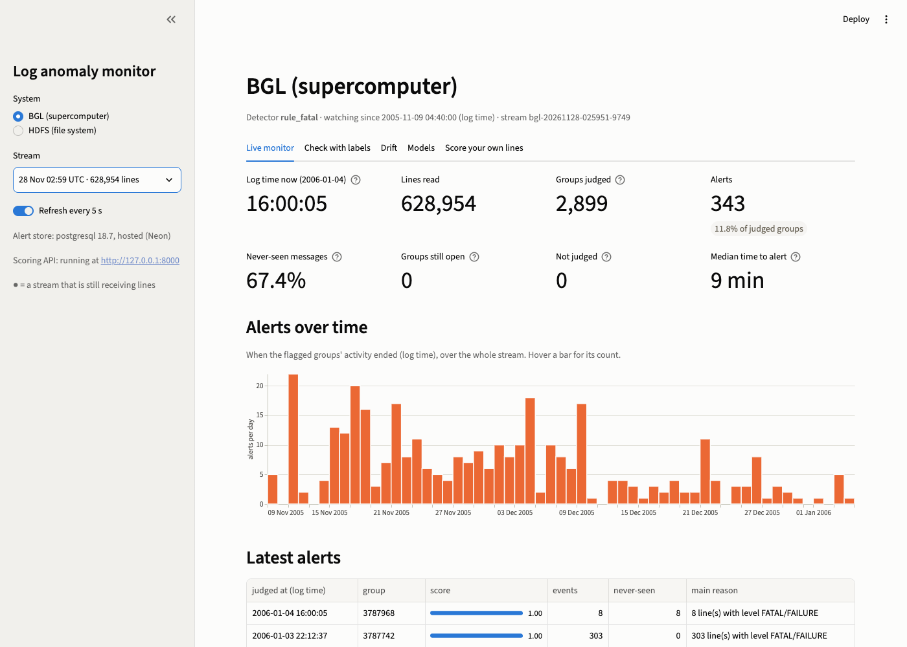
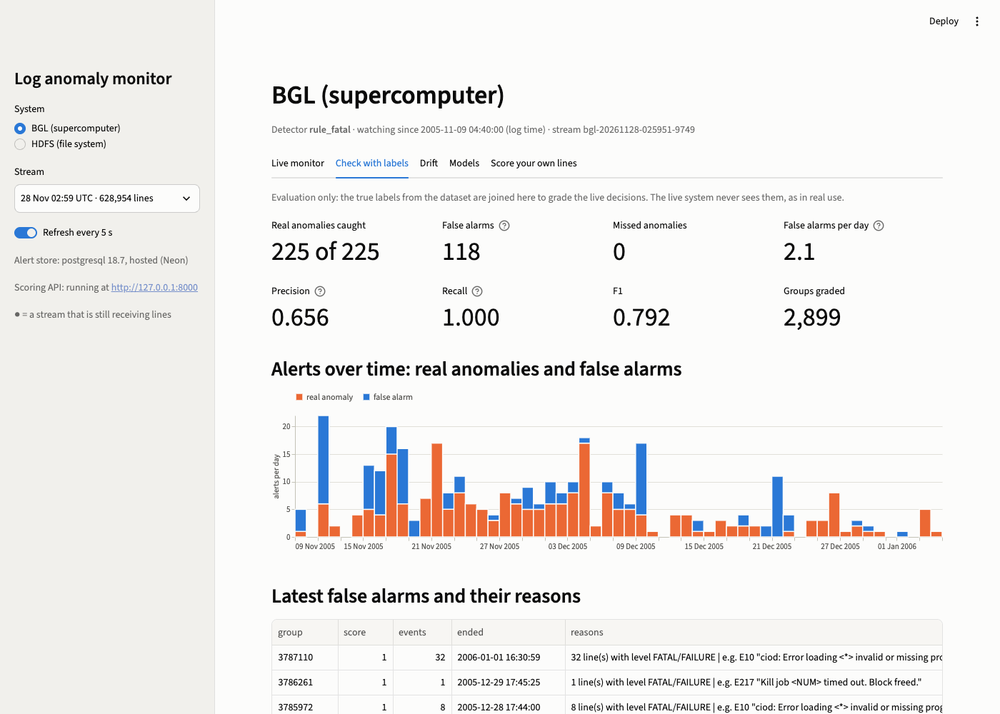
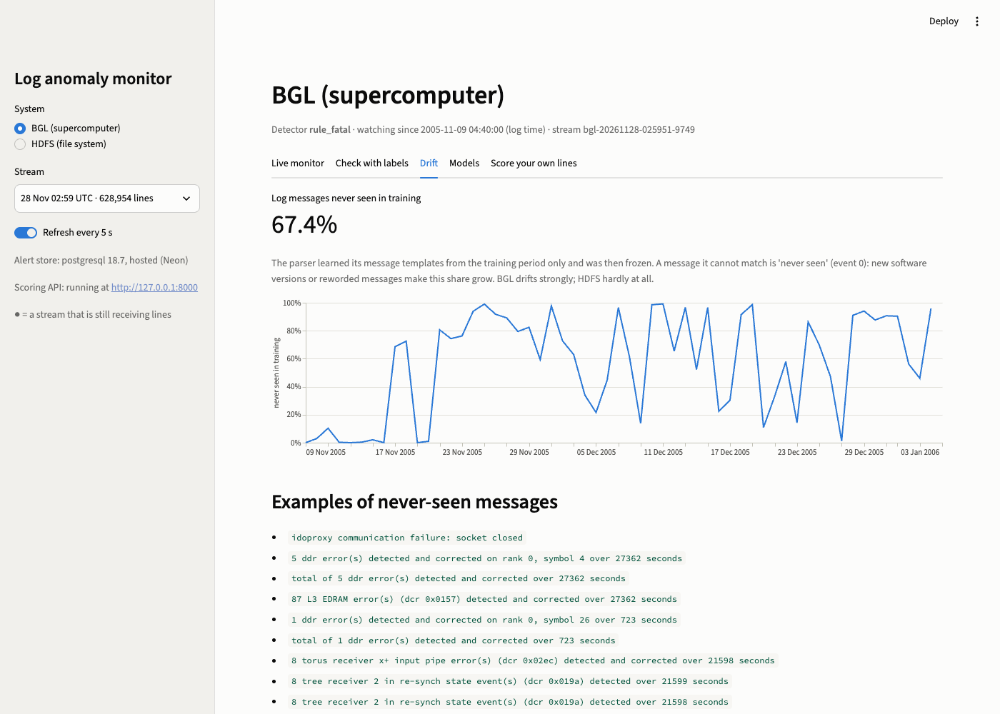
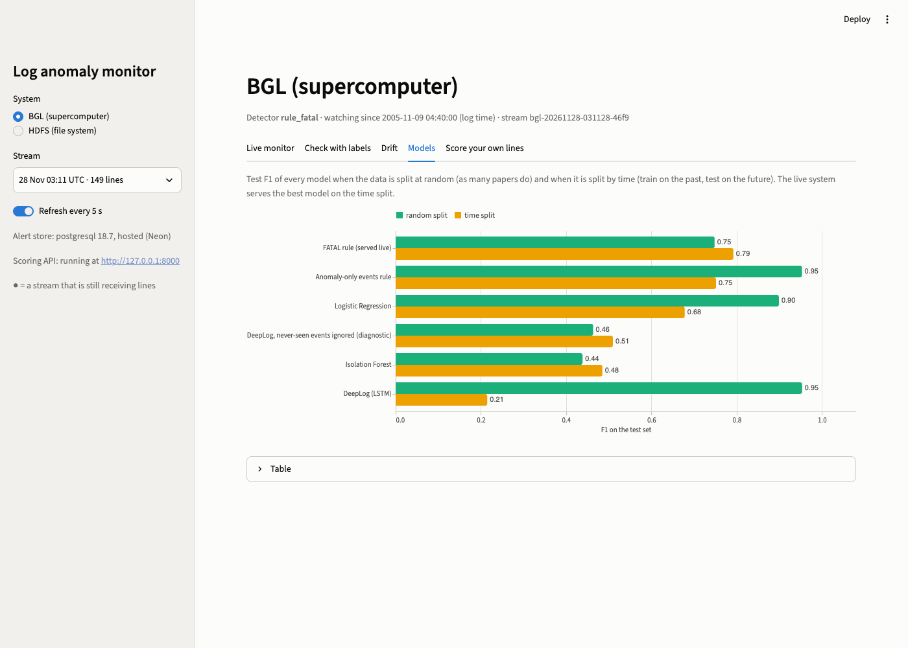

# Milestone 3, step 4 – Live dashboard

**Goal of this step:** a web page where a person can **watch the live system** and **judge whether to trust it**:
- what it flags, and why;
- how good its decisions really are;
- how much the logs have drifted;
- how the models compare.

It reads the alert store (PostgreSQL on Neon) that the scoring API fills (step 3).

Code:
- [`dashboard/app.py`](../dashboard/app.py): the page.
- [`src/dashboard_data.py`](../src/dashboard_data.py): the numbers, kept separate so they can be tested.
- [`.streamlit/config.toml`](../.streamlit/config.toml): the theme.
- Tests: [`tests/test_dashboard.py`](../tests/test_dashboard.py).

```bash
streamlit run dashboard/app.py          # then open http://localhost:8501
# to watch it live, in two more terminals:
uvicorn src.api:app                     # the scoring API (stores results in the database from .env)
python -m src.replay --dataset bgl      # the live log feed
```

---

## 1. What is Streamlit?

**Streamlit** turns a Python script into a web page. Each `st.metric`, `st.dataframe` or
`st.altair_chart` call draws one element. When something changes (you click, or the timer fires),
the script runs again and the page updates.

It was named in Milestone 1. It's Python, so it reuses the project's code directly, with no separate
web front end to build. Charts are drawn with **Altair**, a Python library for interactive charts
(hover tooltips).

---

## 2. The five tabs

The sidebar picks the **system** (BGL or HDFS) and the **stream**: one replay or monitoring
session, newest first. A **●** marks a stream that is still receiving lines. The page refreshes
every 5 seconds; this can be switched off.

### Live monitor: what the system decided



| Number | Meaning |
|---|---|
| Log time now | The latest timestamp the system has read |
| Lines read / Groups judged / Alerts | Volume, and how many finished groups were flagged |
| Never-seen messages | Share of log messages the parser never saw in training (drift) |
| Groups still open | Waiting to be finished (an HDFS block needs 13 h of silence) |
| Not judged | Groups that may have started before monitoring began (cold-start rule, docs/06 §2) |
| Median time to alert | Log time from a group's last event to its alert |

Below them:
- **Alerts over time**, over the whole stream;
- the **latest alerts**;
- **"Why was it flagged?"**, which shows the reasons the detector gave and any never-seen messages.

This tab uses **no labels**, only what the live system itself knows.

### Check with labels: how good are the decisions?



The true labels from the dataset are joined here **to grade the live system**. It never sees them,
as in real use. The tab shows:
- real anomalies caught, false alarms and missed anomalies;
- precision, recall and F1;
- **false alarms per day** (promised in Milestone 1);
- alerts over time split into real anomalies (orange) and false alarms (blue);
- the latest false alarms with their reasons, which is the starting point for the error analysis (step 6).

An HDFS block that was cut in two by the quiet time counts once: as flagged if any of its pieces was.

### Drift: how much has the log changed?



This is the share of messages the parser never saw in training, per day or hour, with real
examples. On BGL it is close to 0% at first. From mid-November 2005 it is mostly 50–100%, with a
few quieter days: the system's log messages changed after the training period. This is what
breaks DeepLog on BGL's time split, where 99.9% of its false alarms involve never-seen events
(docs/03).

### Models: the research question



Test F1 of every model, **random split vs time split**, with the served model marked. Hovering a
bar shows the 95% confidence interval, precision and recall.

### Score your own lines

Paste raw log lines. They're sent to the API (`POST /score`), and the groups come back with score,
label and reasons. This needs the API to be running.

---

## 3. What the dashboard shows for the two test periods

Both test periods were replayed into the database ([`scripts/11_check_replay.py`](../scripts/11_check_replay.py)):

| | BGL (FATAL rule) | HDFS (Logistic Regression) |
|---|---|---|
| Log time covered | 56.5 days | 3.6 hours |
| Groups judged | 2,899 | 115,028 |
| Alerts | 343 | 1,758 |
| Real anomalies caught | **225 of 225** | **1,669 of 1,680** |
| False alarms | 118 | 89 |
| Precision / recall | 0.656 / 1.000 | 0.949 / 0.993 |
| F1 | **0.792** (offline: 0.792) | **0.971** (offline: 0.974) |
| **False alarms per day** | **2.1** | **599** |
| Never-seen messages | 67.4% | 0.0% |
| Median time to alert (this fast replay) | 9 min | 2.0 h |

**Why HDFS shows 0.971 and not 0.974:** the live system also judged 16 groups that are outside the
offline test set:
- the 10 normal blocks cut in two by the 13-hour quiet time, whose pieces are false alarms (docs/06 §2);
- 6 complete validation blocks that started in the same second as the test period (1 anomaly, correctly caught).

Without them the numbers are exactly the offline ones.

**False alarms per day changes the picture.** HDFS has the better F1 (0.97 vs 0.79), but it
would raise about **600 false alarms a day**, against **2 a day** on BGL. HDFS is a busy system:
115,000 blocks in 3.6 hours, so even a 0.08% false-alarm rate (89 of about 113,000 normal blocks) is hundreds a day. A score like F1
hides this, which is why Milestone 1 promised this metric. Step 6 analyses it properly.

**Median time to alert** depends on how the stream was replayed:
- these runs were replayed as fast as possible, without a clock signal, so a BGL window waited for
  the next line (docs/06 §4);
- all HDFS blocks were judged at the end of the log.

---

## 4. Design decisions

| Decision | Why |
|---|---|
| The dashboard reads the **database**, not the API | It still works when the API is down, shows the history of every stream, and any number of people can watch |
| **Numbers** (`src/dashboard_data.py`) are kept apart from the **page** (`dashboard/app.py`) | The numbers can be unit-tested; the page only arranges them |
| Labels are used **only** in the "Check with labels" tab | The live view must show only what a real monitor would know |
| Only the data parts refresh, every 5 s (`st.fragment`), and results are cached for 5 s | Smooth live updates, at most one database query per table every 5 s |
| Charts span the **whole stream**, with hover tooltips | One alert is not drawn as a page-wide bar; exact values are one hover away |
| Same colours as the report: **orange = alert / abnormal**, **blue = normal**, green/amber = random/time split | A reader learns the colours once |
| Light theme fixed, usage statistics switched off | Matches the report figures; nothing is sent to Streamlit's servers |
| Charts read 8 small columns (no reasons); reasons only for the latest 50 alerts | Even the largest stream (115,000 groups) loads from Neon in 0.7 s |

**Tested:**
- unit tests for every number;
- a test that runs the **whole page** on a small SQLite database (Streamlit's `AppTest`);
- screenshots of every tab in a real browser (Chrome), at desktop and phone width.

---

## 5. Limitations

- **No login:** anyone who can open the page sees the alerts. That's fine on one computer for a demo.
- **Polling:** the page asks the database every 5 seconds rather than being told about new alerts.
  That's simple and enough here.
- **Whole streams are loaded:** fine up to a few hundred thousand groups; much bigger streams would
  need the counting done inside the database.
- **The labels come from the dataset.** A real system has no labels, so in practice the "Check
  with labels" tab would need people to confirm or reject alerts.

---

## 6. Questions a lecturer might ask

**Why does the dashboard read the database instead of asking the API?** The API knows only the
current stream and keeps it in memory. The database has the full history of every stream, survives
restarts, and can be read by many viewers without slowing the scoring.

**How do you keep the live view honest?** It shows only what the live system decided. The true
labels appear only in a separate, clearly marked evaluation tab.

**What does "false alarms per day" tell you that F1 does not?** The workload for the people on
call. HDFS has the better F1 but about 600 false alarms a day, because it handles so many blocks.
BGL has about 2. A model with a great F1 can still be unusable in operation.

**Why is the HDFS F1 on the dashboard 0.971, not 0.974?** It includes 10 false alarms from blocks
cut in two by the 13-hour quiet time, and 6 validation blocks. Those groups only exist in live
operation. Without them the numbers match the offline evaluation exactly.

**How did you test a web page?** The numbers have unit tests. Streamlit's `AppTest` runs the whole
page on a small test database and checks that there are no errors and that the numbers are right.
Screenshots in a real browser checked the layout.
