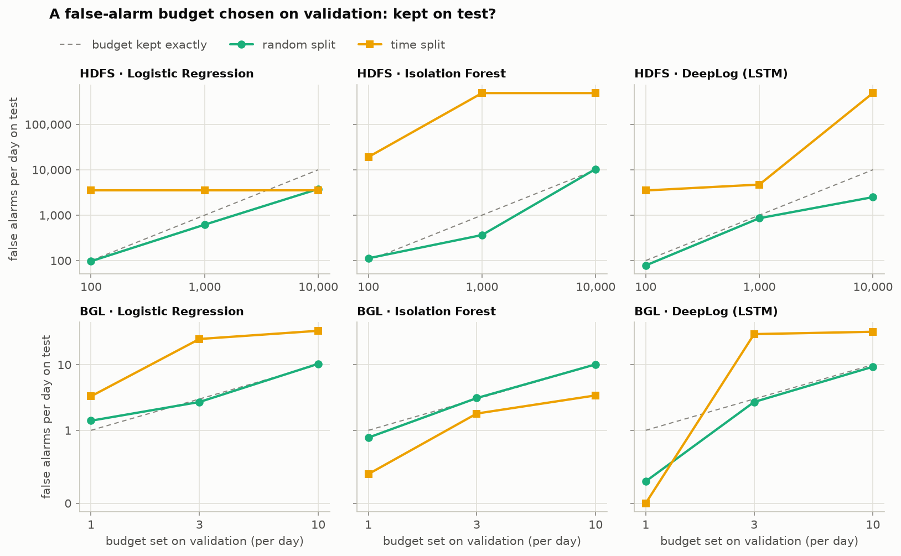

# Step 9 – False alarms per day and error analysis

**Goal of this step:** look at the detectors the way the **people on call** would.

- How much work do the alerts cause per day? This is the false-alarms-per-day measure promised in the project proposal.
- Does a false-alarm limit set on the past hold in the future?
- What exactly are the errors of the two detectors the live system serves, and can they be fixed?

Code:
- [`src/operations.py`](../src/operations.py): the measures.
- [`src/rules.py`](../src/rules.py): the refined FATAL rule.
- [`scripts/12_false_alarms.py`](../scripts/12_false_alarms.py): parts 1 and 2.
- [`scripts/13_error_analysis.py`](../scripts/13_error_analysis.py): parts 3 and 4.
- Tests: [`tests/test_operations.py`](../tests/test_operations.py).

```bash
python scripts/12_false_alarms.py      # ~10 s -> false_alarms_per_day.csv, alert_budget.csv, figure 13
python scripts/13_error_analysis.py    # ~5 s  -> error_analysis_hdfs.csv, error_analysis_bgl.csv, fatal_rule_refined.csv
```

---

## 1. False alarms per day

**Definition:** false alarms on the test set ÷ the number of days of log the test set stands for.

- **Time split:** the test set is one continuous period, from the start of its first group to
  the start of its last (plus one 5-minute window for BGL).
  - HDFS: **3.4 hours** (0.140 days).
  - BGL: **56.5 days**.
- **Random split:** the test set is a random 20% of all groups, spread over the whole log, so it
  stands for 20% of the log's length.
  - HDFS: 0.32 days.
  - BGL: 42.9 days.

The dashboard's figure for HDFS (599 a day, docs/07) is a little higher. It counts the live run's
time from the first event to the last alert, and also includes the 10 blocks cut in two by the
quiet time.

**Time split, test set** ([`false_alarms_per_day.csv`](../reports/results/false_alarms_per_day.csv)):

| Dataset | Detector | F1 | False alarms | **False alarms per day** | All alerts per day | Alerts read per real anomaly |
|---|---|---|---|---|---|---|
| HDFS | **Logistic Regression** (served) | 0.974 | 79 | **564** | 12,474 | 1.05 |
| HDFS | DeepLog | 0.819 | 740 | 5,284 | 17,273 | 1.44 |
| HDFS | Isolation Forest | 0.043 | 68,499 | **489,117** | 500,113 | 45.5 |
| HDFS | Anomaly-only rule | 0.604 | 0 | 0 | 5,184 | 1.00 |
| BGL | **FATAL rule** (served) | 0.792 | 118 | **2.1** | 6.1 | 1.52 |
| BGL | Logistic Regression | 0.678 | 7 | 0.1 | 2.2 | 1.06 |
| BGL | DeepLog | 0.215 | 1,635 | 29.0 | 32.9 | 8.3 |
| BGL | Isolation Forest | 0.485 | 0 | 0 | 1.3 | 1.00 |

**What this shows:**

- **F1 does not measure workload.** HDFS Logistic Regression has the best F1 in the project but
  raises **564 false alarms a day**. The BGL FATAL rule has a lower F1 (0.79) but raises **2 a day**.
  The reason is traffic: in its test period HDFS processes about **820,000 blocks a day**, so even
  7 false alarms per 10,000 normal blocks is hundreds a day. BGL has about 51 windows a day.
- **HDFS is too busy for one alert per block.** Even the *real* alerts come at 12,000 a day.
  - Bundled into one notification per 10 minutes, as an alerting tool would do, that becomes **150
    notifications a day, and none of them is false**: every 10-minute period contained a real anomaly.
  - So for HDFS the question is less "is this alert real?" than "which of the many anomalous
    blocks matter?". Ranking by score helps there.
- **BGL bundled:** the FATAL rule sends 5.2 notifications a day, 1.7 of them false. DeepLog sends
  25.7, of which 22.2 are false: about 9 in 10 of its messages would be wrong.

---

## 2. Does a false-alarm budget hold?

A team usually decides how many false alarms it can live with, for example **10 a day**. The detector's
threshold is then chosen so that it keeps that budget on recent data (validation). The question
is whether the future keeps the promise.

**Method** ([`scripts/12_false_alarms.py`](../scripts/12_false_alarms.py)), for each scoring model, split and budget:
- the threshold is chosen on the validation period so that it has at most *budget × days*
  false alarms;
- the test period then shows the real rate.

The budgets are 100 / 1,000 / 10,000 a day for HDFS and 1 / 3 / 10 a day for BGL (BGL has only
about 51 windows a day).



How many times the budget the test period really produced ([`alert_budget.csv`](../reports/results/alert_budget.csv)):

| | Random split | Time split |
|---|---|---|
| HDFS Logistic Regression | 0.4–1.0× | **up to 35×** (budget 100 → 3,485 a day; kept only at 10,000 a day) |
| HDFS Isolation Forest | 0.4–1.1× | **49–489×** (budget 1,000 → 489,117 a day) |
| HDFS DeepLog | 0.3–0.9× | **5–49×** |
| BGL Logistic Regression | 0.9–1.4× | **3.3–8.2×** (budget 3 → 24.6 a day) |
| BGL Isolation Forest | 0.9–1.1× | 0.3–0.6× (kept) |
| BGL DeepLog | 0.3–0.9× | **3.2–9.7×** (except budget 1, where it raises nothing and catches nothing) |

**Finding: with a random split, a budget chosen on validation holds.** Validation and test are the
same mix, so the dashed line in the figure is followed. **With a time split it breaks**, by
3–10 times on BGL, and on HDFS by up to 35 (Logistic Regression), 49 (DeepLog) and 489 (Isolation
Forest) times. A team that tuned its alerting on a random
split would be flooded in production. This is the research question seen from the operator's side.

**Why HDFS breaks so badly:**
- the validation period lasts only **1.7 hours**, too short to estimate a daily rate (the same lesson
  as the 13-hour quiet time in docs/05);
- and in the test period the *normal* workload changed (docs/03 §10.2, and section 3 below).

Only Isolation Forest on BGL stays under budget, and only by flagging little: recall 35–51%.

---

## 3. Error analysis: HDFS, Logistic Regression (served)

79 false alarms and 11 missed anomalies on the time-split test set ([`error_analysis_hdfs.csv`](../reports/results/error_analysis_hdfs.csv)).
Each error's **event-count pattern** (what the model sees, e.g. `E1x3 E2x1 E5x3`) was looked up in
the training data:

| | Never seen in training | Seen only as normal | Seen only as abnormal |
|---|---|---|---|
| False alarms (79) | 77 | 2 | 0 |
| Missed anomalies (11) | 5 | 0 | 6 |

**No test pattern carries both labels.** So no error was unavoidable for a count-based model:
the right information was in the counts.

**76 of the 79 false alarms are one single pattern**, never seen in training:

`E1x4 E2x1 E3x3 E4x3 E5x4 E6x1 E7x1 E11x1 E12x1`

- A **normal** HDFS block is written to 3 machines (3× "Receiving block", 3× "addStoredBlock"),
  and its file is later deleted ("Deleting block", "NameSystem.delete").
- These 76 blocks got an **extra, 4th copy**: "ask … to replicate" (E11), "Starting thread to
  transfer" (E12), "Transmitted block" (E7). They were **kept, not deleted**.
- In training, blocks with an extra copy were **91.4% abnormal** (1,495 blocks), because
  re-replication usually followed a failure. So the model learned "extra copy = problem".
- In the test period, re-replication of kept files became normal behaviour. This is part of the
  workload change found in docs/03 §10.2: 60% of normal test blocks are never deleted, against 9%
  in training.

**The 11 missed anomalies are rare variants**, also involving re-replication:
- 6 have a pattern seen in training **only twice** (both abnormal). A linear model cannot learn a
  pattern from two examples, so it scored them 0.001 against a threshold of 0.091.
- 5 have patterns never seen in training that resemble normal blocks.

**What would help:** more training data from the new workload, or features that describe *why*
a block was re-replicated rather than just counting events.

---

## 4. Error analysis: BGL, FATAL rule (served)

118 false alarms, 0 missed ([`error_analysis_bgl.csv`](../reports/results/error_analysis_bgl.csv)).

**None of the 28,585 FATAL/FAILURE lines in the false-alarm windows is a real alert.** The rule
treats a severity level as an alert, but the experts who labelled BGL did not. The message types
behind the false alarms:

| Message type (FATAL/FAILURE) | False-alarm windows | In training |
|---|---|---|
| ciod: Error loading … invalid or missing program image, No such file | 30 | 38,752 FATAL lines, **never an alert** |
| (a message never seen in training) | 22 | – |
| Kill job … timed out. Block freed. | 20 | 223 lines, never an alert |
| ciod: LOGIN … failed: No such file or directory | 16 | 39,568 lines, never an alert |
| ciod: Error loading … program image too big | 15 | 1,176 lines, never an alert |
| ciod: Error loading … invalid or missing program image, Permission denied | 15 | 21,792 lines, never an alert |

These are messages from **ciod**, the service that starts users' programs on the compute nodes:
- a program could not be loaded;
- a login failed;
- a job timed out.

These are failed *user jobs*, not failures of the machine. They are logged as FATAL, but in
training they were **never** part of a real alert. **So the information to avoid most of these
false alarms was already in the training data.**

### Follow-up: the FATAL rule without the messages that were never alerts

**New rule:** a window is flagged if it has a FATAL/FAILURE line whose message type was **not**
"FATAL in training at least 20 times and never an alert". Notes:
- The list is built from **training data only** (101 message types on the time split).
- Never-seen messages are never ignored, since what is unknown cannot be known to be harmless.

[`fatal_rule_refined.csv`](../reports/results/fatal_rule_refined.csv):

| BGL | FATAL rule | **FATAL rule minus never-alert messages** |
|---|---|---|
| Time split, **validation** | F1 0.423 (60 false alarms) | **F1 0.917** (4 false alarms) |
| Time split, **test** | F1 0.792 (118 false alarms, 2.1 a day) | **F1 0.947** (24 false alarms, **0.4 a day**), recall 0.996 |
| Random split, test | F1 0.748 | F1 0.959 |

- It is the **best BGL detector in the project on the time split** (Logistic Regression 0.678,
  DeepLog 0.215, anomaly-only rule 0.751). Its random-to-time drop is small (0.959 → 0.947): it
  holds up over time.
- **Honesty note:** the idea came from looking at test errors, which is a risk of fitting the
  test set. Three things reduce that risk:
  - the list is learned from training data only;
  - **the validation period alone shows the same improvement** (0.42 → 0.92), so it would have
    been chosen without the test set;
  - the minimum of 20 lines does not matter: 5, 20 or 100 give the same test result.
- **The one anomaly it misses** is a window of 299 "ciod: LOGIN … failed: Permission denied" lines
  that the experts labelled an application alert (category APPOUT). In training the same message
  type was FATAL many times and **never** an alert. The labels themselves are inconsistent here,
  so no rule learned from the past could get it right.
- 22 false alarms remain from **never-seen messages**. A list from the past cannot cover them;
  that is the drift (docs/07).

**Not yet served live:** the live system still runs the original FATAL rule. Adding the refined rule
would change the engine, API and dashboard, and is a separate decision.

---

## 5. Summary of findings

1. **False alarms per day changes the ranking.** HDFS Logistic Regression has F1 0.97 but 564
   false alarms a day; the BGL FATAL rule has F1 0.79 but 2 a day. Volume decides the workload.
2. **A false-alarm budget set on validation holds with a random split and breaks with a time split**
   (3–10× on BGL, up to 35–489× on HDFS). The random split hides the operational risk, not only the
   F1 drop.
3. **The served HDFS model's false alarms are one new normal behaviour**: re-replication of
   kept files. It was 91% abnormal in training. Its misses are rare patterns seen at most twice.
4. **The served BGL rule's false alarms are failed user jobs** logged as FATAL, which were never
   alerts in training. Ignoring those message types takes F1 from **0.79 to 0.95** on the time
   split, and validation alone shows the same.
5. **Labels have limits:** BGL contains a message type that was harmless in training and an alert
   in test.

---

## 6. Limitations

- **The HDFS test period lasts 3.4 hours.** Daily rates from it are extrapolations, and the busy
  test period (about 820,000 blocks a day) makes them high. The BGL figures come from 56 days and
  are more reliable.
- **"False alarm" means "not labelled as an anomaly".** Some false alarms may be real problems
  the labels missed, and the BGL labels are inconsistent for at least one message type.
- **Bundling** uses fixed 10-minute periods. Real alerting tools also group by machine or service.
- The refined FATAL rule was evaluated after the error analysis. Its validation result supports
  it, but a fully clean test would need data from after January 2006.

---

## 7. Questions a lecturer might ask

**Why report false alarms per day when you already have F1?** F1 is a ratio and ignores volume.
The people on call care about how many alerts a day they must check. HDFS has the best F1 but
the most false alarms per day, because it processes about 820,000 blocks a day.

**How do you compute false alarms per day for a random split?** The random test set is 20% of all
groups, spread over the whole log, so it stands for 20% of the log's length. For the time split it
is simply the test period's length.

**What is the alert-budget experiment?** Choose the threshold on validation so that it would raise
at most B false alarms a day, then count how many the test period really raises. With a random split
the promise holds; with a time split it breaks by up to 489 times.

**Why does the HDFS model raise false alarms?** 76 of its 79 false alarms are one new kind of normal
block: one that got an extra copy and was kept. In training, extra copies were 91% abnormal.

**Isn't the refined FATAL rule fitted to the test set?** The idea came from test errors, so I treat it
carefully. The list is learned from training data only. The validation period shows the same jump
(0.42 → 0.92), so the decision could have been made without the test set. And the one setting does
not change the result.

**Why not serve the refined rule live right away?** It changes the served detector, so the engine,
API and dashboard would need updating and re-checking. It is the clear next improvement.
